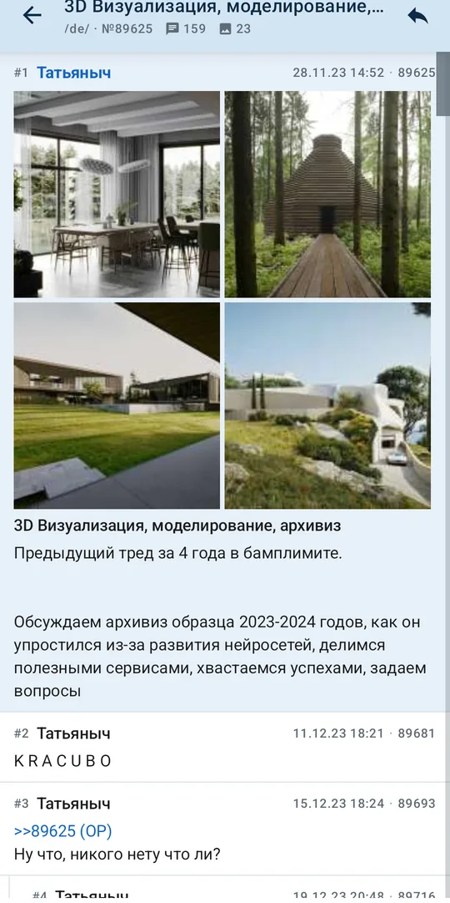
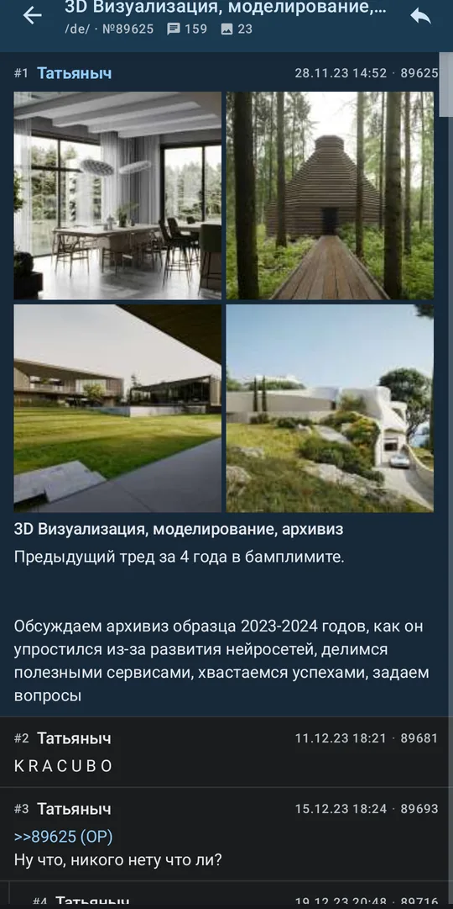

# Vibe-2ch — клиент двача для Android

[](https://github.com/kashimkhv/Vibe-2ch/actions/workflows/android.yml)

Клиент 2ch.hk на Kotlin и Compose: читает JSON API движка и рисует посты сам,
HTML-страницы не рендерит. Без рекламы, трекеров и аккаунта. Код открытый, MIT.

<p align="center">
  
  
  
  
</p>

**Скачать:** [APK последнего релиза](https://github.com/kashimkhv/Vibe-2ch/releases/latest) ·
Android 8.0+ · 4,5 МБ. Обновления — в приложении: «Настройки → Проверить обновления».

## Что умеет

- **доски** — поиск, категории, закреплённые наверху, активность доски в шапке;
- **лента** — карточки с превью ОП (до четырёх, остальное в «+N»), автоподгрузка
  следующей страницы, закрепы с пометкой бамп-лимита, скрытие тредов долгим нажатием;
- **тред деревом** — ответ встаёт под цитируемым постом с отступом и одной
  направляющей линией, номер поста в шапке (#12), тап по цитате прокручивает
  к посту и подсвечивает его;
- **место чтения** — возврат в тред открывает там, где остановились, в том числе
  после перезапуска приложения;
- **медиа** — полноэкранный просмотр с зумом, листание вложений свайпом, свой
  плеер webm/mp4, скачивание текущего файла;
- **постинг** — ответ, ответ с цитатой, новый тред, sage, вложение с проверкой
  лимитов доски до отправки; эмодзи-капчу решает человек, не скрипт;
- **под себя** — девять шрифтов отдельно для заголовков, меты и текста, размер
  и жирность каждого, межстрочный интервал, боковые поля, отступ дерева ответов,
  размер и обрезка превью, спойлеры;
- **темы** — светлая по умолчанию, системная и тёмная;
- **ссылки** — ссылка на 2ch.hk из браузера или чужого приложения открывается
  в клиенте, якорь `#123` ведёт сразу к посту;
- **сеть** — куки движка переживают перезапуск, кэш картинок с ручной очисткой,
  проверка обновлений с GitHub Releases.

## Чего пока нет

Каталог тредов, поиск по постам, автообновление треда, постинг с пасскодом
и с картинки-капчи.

## Сборка

```bash
export JAVA_HOME=/path/to/jdk-21   # JDK 21 и Android SDK с платформой 37
./gradlew :app:assembleDebug       # debug встаёт рядом с release
./gradlew :app:testDebugUnitTest   # 225 тестов
./gradlew :app:assembleRelease     # R8 + shrinkResources, нужен keystore
```

Стек: Kotlin 2.4, Jetpack Compose, Hilt, Room, DataStore, Retrofit + OkHttp,
Coil, Media3. `minSdk 26`, `targetSdk 36`.

## Как это сделано

Подробный технический документ — [docs/DETAILS.md](docs/DETAILS.md): API движка
(все эндпоинты 2019 года мертвы), раскладка поста, дерево ответов, постинг
и эмодзи-капча, кэш и его ловушки, тесты, безопасность, принятые решения.

## Лицензия

MIT, см. `LICENSE`. Оригинал 2019 года — [vortexwolf/2ch-Browser](https://github.com/vortexwolf/2ch-Browser).
