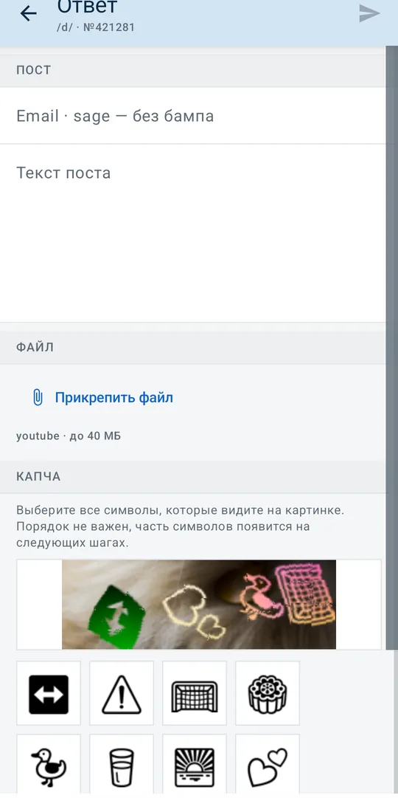
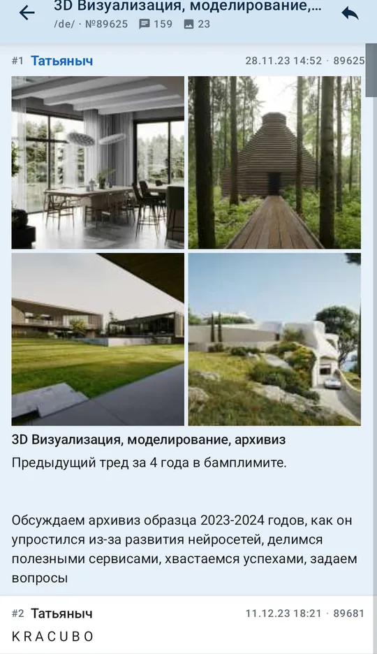
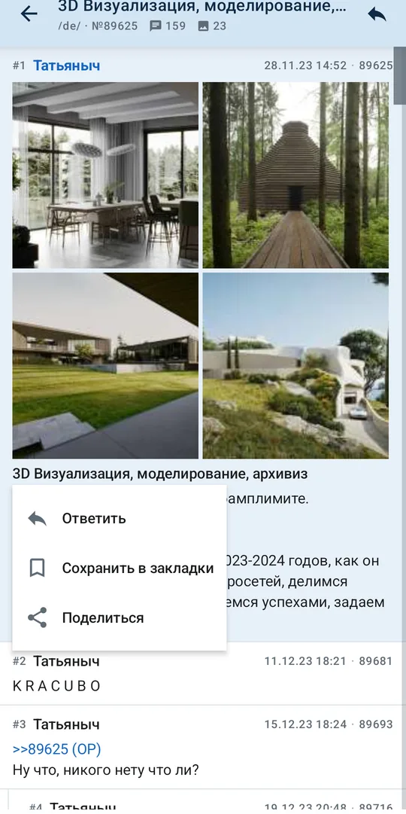
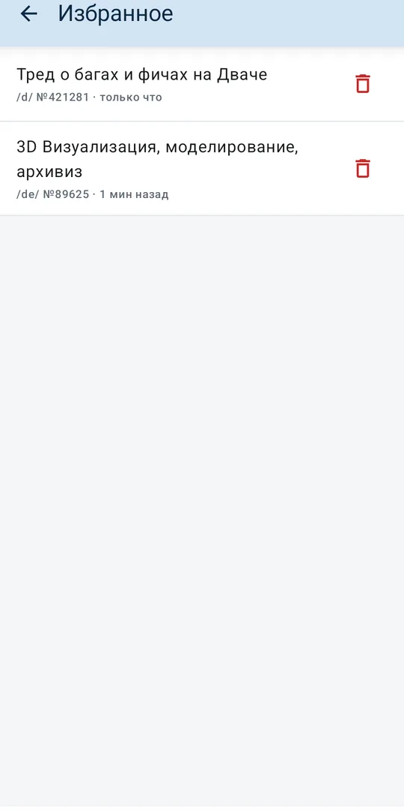
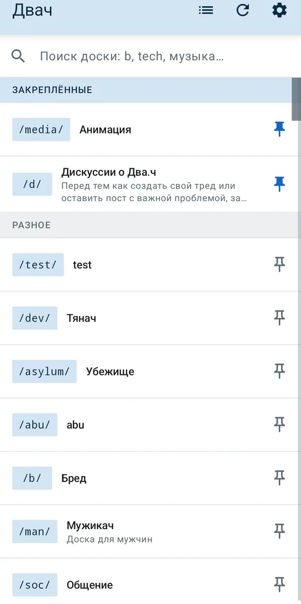
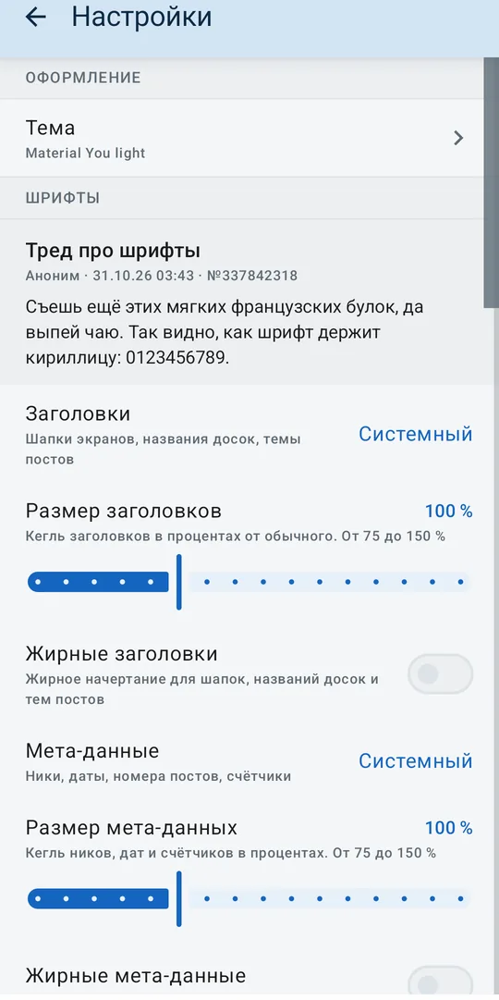
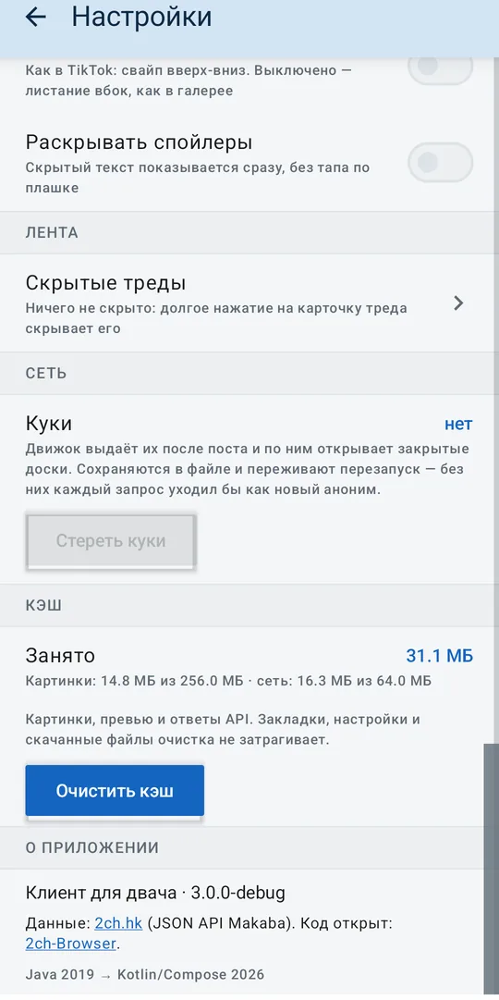
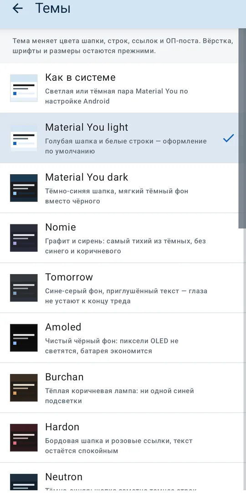
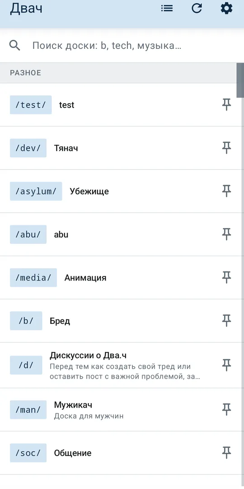

# Двач — клиент 2ch.hk на Kotlin + Compose

[](https://github.com/kashimkhv/Vibe-2ch/actions/workflows/android.yml)

Переписанный с нуля Android-клиент двача. Оригинал — [vortexwolf/2ch-Browser](https://github.com/vortexwolf/2ch-Browser)
(Java, MVP + Moxy, RxJava 2, support-library 27, последний коммит — июль 2019).
Здесь тот же продукт, но на актуальном стеке 2026 года: Kotlin 2.4, Compose, корутины, Hilt, Room.

<p align="center">
  
</p>

## Стек

| Слой | Чем сделано |
|---|---|
| Язык | Kotlin 2.4.21 (K2), JDK 21, jvmTarget 17 |
| UI | Jetpack Compose (BOM 2026.09.00), Material 3, dynamic color |
| Навигация | Navigation Compose с type-safe маршрутами (`@Serializable`) |
| Асинхронность | Coroutines + Flow / StateFlow, без RxJava |
| DI | Hilt 2.60 (KSP, без kapt) |
| Сеть | Retrofit 3 + OkHttp 5 + kotlinx.serialization |
| Картинки | Coil 3 (общий OkHttp-клиент и кэш, анимированные GIF) |
| Медиа | Media3 ExoPlayer 1.11 (webm/mp4) + свой зум-просмотрщик картинок |
| Локальные данные | Room 2.8 (избранное, история) + DataStore (настройки) |
| Сборка | AGP 9.4.1, Gradle 9.8.2, version catalog, configuration cache |

`minSdk 26`, `compileSdk 37.2` (`compileSdkMinor = 2` — в AGP 9 минорная версия
платформы задаётся отдельно), `targetSdk 36`.

## Про API: старые эндпоинты мертвы

Приложение 2019 года ходило на `/boards.json`, `/makaba/mobile.fcgi?task=get_boards`,
`/makaba/posting.fcgi`. В 2026 всё это отдаёт `404`. Живые эндпоинты, на которых
работает этот клиент:

| Что | Эндпоинт |
|---|---|
| Список досок | `GET /api/mobile/v2/boards` |
| Список тредов, 1-я страница | `GET /{board}/index.json` (`current_page=0`, вместе с закрепами) |
| Список тредов, страница N | `GET /{board}/{N}.json`, N с единицы — это **вторая** страница (`/b/1.json`) |
| Каталог | `GET /{board}/catalog.json` (пока не используется) |
| Тред целиком | `GET /{board}/res/{num}.json` |
| Постинг | `POST /user/posting` (multipart) |
| Капча | `/api/captcha/emoji/id`, `/api/captcha/emoji/show`, `/api/captcha/emoji/click` |

2ch.hk за Cloudflare, поэтому запросы идут с UA десктопного браузера
(см. `NetworkModule`).

### Пагинация: `?page=N` больше не работает

Раньше страница выбиралась query-параметром `index.json?page=N`. Сейчас движок
его молча игнорирует и всегда отдаёт первую страницу (`current_page=0`), поэтому
листание «не работало»: номер страницы приходил тот же, треды те же. Живой способ —
путь с номером страницы, где `index.json` — нулевая, а `1.json` — следующая:

```
GET /b/index.json   → current_page=0, живая первая страница (с закрепами)
GET /b/1.json       → current_page=1, вторая страница
GET /b/2.json       → current_page=2, третья
GET /b/10.json      → 404 (у /b max_pages=10)
```

`index.json` и `1.json` — соседние страницы, а не два снимка одной: общих
тредов у них ноль. На `/news/` это было видно особенно наглядно — в `1.json`
не хватало нескольких самых свежих новостей, и клиент, бравший первую страницу
оттуда, их не показывал.

В коде нулевая страница — это `DvachApi.index()` (`index.json`), остальные —
`DvachApi.indexPage(board, page)`; `ChanRepository.index()` больше ничего к
номеру не прибавляет.

#### Бесконечная лента вместо кнопок

Кнопок «страница вперёд/назад» в списке тредов больше нет. Лента грузится сама:
когда до конца остаётся три карточки (`LOAD_MORE_PREFETCH`), `ThreadsScreen`
через `snapshotFlow { listState.layoutInfo.visibleItemsInfo.lastOrNull()?.index }`
зовёт `ThreadsViewModel.loadMore()`, и следующая страница приклеивается к списку.

- порядок сохраняется, дубли отбрасываются: пока листали, тред с бампом мог
  переехать на следующую страницу, поэтому `mergeThreads()` склеивает страницы
  через `distinctBy { num }`;
- догрузка останавливается, когда страница пришла заполненной не полностью или
  достигнут предел страниц доски (`canGoNext()`);
- низ списка — футер: спиннер, «Не удалось загрузить — повторить» после ошибки
  или «Конец списка». Пока ошибка не снята, авто-подгрузка не повторяет запрос
  сама (иначе долбила бы сервер), повтор — только по кнопке (`loadMore(force = true)`);
- «Обновить» в шапке и повтор после ошибки первой страницы вызывают
  `loadFirstPage()`: список начинается заново с первой страницы.

#### Тихий refresh при возврате из треда

Лента — снимок на момент запроса: если ответить в треде и вернуться, счётчики
постов оставались прежними, тред не вставал по бампу, а удалённый на движке
тред висел в списке до ручного «Обновить». Теперь `ThreadsScreen` на
`ON_RESUME` зовёт `ThreadsViewModel.refreshQuietly()`: первая страница
перезапрашивается, но интерфейс об этом молчит — ни спиннера в шапке, ни
ошибки. При сбое сети список остаётся прежним: для явного обновления с ошибкой
есть «Обновить».

Что именно подменяется, решает `mergeFirstPage()`:

- догруженных страниц нет (`page == 0`) — список заменяется свежей первой
  страницей целиком, поэтому умерший тред из ленты пропадает;
- страницы догружены — свежая первая встаёт наверх, а догруженный хвост
  остаётся под ней (`fresh + loaded.filterNot { it.num in freshNums }`), так что
  возврат из треда не схлопывает ленту до одной страницы. Совпавшие номера
  берутся из свежей страницы: у неё новые счётчики и порядок;
- пустая страница не применяется: это скорее сбой движка, чем «доска опустела».

Запросы при этом не спамят: не чаще раза в 5 секунд
(`QUIET_REFRESH_INTERVAL_MS`), не параллельно уже идущей загрузке, а время
считается по попытке, а не по успеху. Позиция в списке не прыгает: у карточек
`key = num`, и `LazyListState` перепривязывает прокрутку к тому же треду
(`updateScrollPositionIfTheFirstItemWasMoved`), даже если он переехал по бампу.
Тред, удалённые не с первой страницы, тихий refresh не убирает: он знает только
про первую — их снимет полное обновление.

### Поле `op` у постов треда всегда 0

В JSON треда (`/res/{num}.json`) у всех постов `op: 0`, включая стартовый, —
по нему нельзя понять, где ОП. Поэтому первый пост треда помечается как ОП
в репозитории (`mapIndexed` в `NetworkChanRepository.thread`). В списке тредов
это поле не нужно: там превью ОП-поста лежит в отдельном объекте `op`, и он
по определению стартовый.

### Постинг и эмодзи-капча

Капчу решает человек: движок присылает картинку-задание и клавиатуру из восьми
символов, а клиент только показывает их и отправляет клики. Порядок такой:

```
GET  /api/captcha/emoji/id?board=…&thread=…   → {result:1, id, type:"emoji", challenge}
GET  /api/captcha/emoji/show?id=…             → {image: base64, keyboard: [8 × base64]}
POST /api/captcha/emoji/click  {captchaTokenID, emojiNumber}
       → {image, keyboard}  ещё не всё найдено (неверный символ возвращает ту же картинку)
       → {success}          это и есть emoji_captcha_id для отправки
POST /user/posting?nc=1  (multipart)          → {result:1, num} (ответ) | {result:1, thread} (тред)
```

Вместе с ID капчи движок отдаёт ещё и задачу «доказательства работы»:

```
challenge: { template: "…%d…", hash: <sha512>, limit: 20000 }
```

Вместе с постом уходит поле `2ch_challenge` — число, при подстановке которого
в `template` вместо `%d` sha512 даёт `hash` (`solveChallenge()`). Задачу решает
клиент, капчу — по-прежнему человек. Без этого поля и без `task=post` (оба есть
в форме самого сайта) движок отвечает `result: 0` **без текста ошибки**, и в
форме нечего показать.

Текстовые поля `name`, `email`, `subject`, `tags`, `usercode` уходят всегда,
даже пустыми. Форма сайта их тоже отправляет в любом случае, а движок на
отсутствующем поле падает с `code = 666` («внутренняя ошибка сервера»):
на `/test/` пост с именем и темой проходил, а ответ без темы — нет.

- токен капчи одноразовый и живёт минуты, поэтому после отказа движка
  (`code = -5` — «капча невалидна», `code = 666` — «внутренняя ошибка», так
  движок называет использованный токен) клиент сразу просит новую;
- ответ на пост начинается с `>>номер` на отдельной строке — иначе движок не
  считает это цитатой (`quotePrefix()`);
- пустой текст допустим только с вложением; тип и размер файла проверяются до
  отправки по настройкам доски (`max_files_size`, `file_types`), сверху ещё
  клиентский потолок 32 МБ;
- `thread` в форме не передаётся при создании треда — по этому движок и
  понимает, что нужен новый;
- после успеха форма закрывается, тред перезагружается и прокручивается к
  новому посту, а номер пишется в `my_posts` (Room, ключ — доска + номер):
  в треде такой пост помечен меткой «мой», серым фоном и синей полосой слева.
  Мостик «форма → тред» — `PostedStore` в памяти: он живёт ровно до возврата
  на экран треда.

<p align="center">
  
</p>

### Чем ответы 2026 отличаются от 2019

Поля поменялись, и старый код на них падал. Что учтено в `ChanRepository`:

| Поле | Поведение |
|---|---|
| `files[].thumbnail` | превью отдаётся здесь; старый `thumbnail`/`path` — запасные варианты |
| `files[].fullname` | исходное имя файла; у части постов пустое или без расширения |
| `files[].displayname` | обрезано (`1793000[...].mp4`), используется только как fallback |
| `files[].duration` | `00:00:14`, у картинок `00:00:00` — не показываем |
| тип файла | по расширению из `path` (webm, mp4, mov, mkv), а не по `name` |
| `files[].size` | **килобайты**, а не байты: 632 → 647 168 байт (`size * 1024`) |

HTML сущности (`&#47;`, `&laquo;`, `&nbsp;`) декодируются до отрисовки: иначе
в интерфейсе видны сырые `WebM&#47;MP4`.

## Сборка

Нужны JDK 21 и Android SDK с платформой 37.

```bash
export JAVA_HOME=/path/to/jdk-21
./gradlew :app:assembleDebug          # app/build/outputs/apk/debug/app-debug.apk
./gradlew :app:testDebugUnitTest      # юнит-тесты
./gradlew :app:assembleRelease        # R8 + shrinkResources, нужен keystore
```

`local.properties` с `sdk.dir` создаётся Android Studio автоматически и в git не попадает.

### Debug и release рядом

Это два разных приложения, они не конфликтуют и могут стоять одновременно:

| | debug | release |
|---|---|---|
| `applicationId` | `io.github.kashimkhv.vibe2ch.debug` | `io.github.kashimkhv.vibe2ch` |
| имя версии | `3.2.1-debug` | `3.2.1` |
| подпись | отладочная | release-ключ |
| оптимизация | без R8 | R8 + `shrinkResources` |
| HTTP-логи | да | нет |

Debug нужен для разработки: он остаётся в репозитории и собирается CI. Release — то,
что публикуется в GitHub Releases.

### Подпись release

Ключ лежит **вне репозитория**, а путь и пароли — в `keystore.properties` в корне
проекта (файл в `.gitignore`, как и `*.jks`):

```properties
storeFile=C:/Users/<вы>/.android-keys/vibe-2ch-release.jks
storePassword=...
keyAlias=vibe2ch
keyPassword=...
```

Без этого файла release соберётся неподписанным (`signingConfig` не создаётся),
debug и тесты это не затрагивает. Если ключ потерян, обновить уже установленное
приложение поверх старой версии нельзя — Android не примет APK с другой подписью,
пользователям придётся удалять приложение и ставить заново.

Проверка подписи и установка:

```bash
$ANDROID_HOME/build-tools/36.0.0/apksigner verify --print-certs \
  app/build/outputs/apk/release/app-release.apk
adb install -r app/build/outputs/apk/release/app-release.apk
```

SHA-256 сертификата: `807ffeae4a4a303cc8366796b1c966b79a4b251760c70ec74afa7710156af36b`.
Версии — по SemVer (`3.0.x` — исправления, `3.x.0` — новые возможности,
`x.0.0` — несовместимые изменения); `versionCode` при каждом релизе только
растёт. Подробности — в `AGENTS.md`.

## Структура

```
app/src/main/java/io/github/kashimkhv/vibe2ch/
├── data/
│   ├── remote/          # Retrofit-интерфейс и DTO движка
│   ├── local/           # Room: избранное, история, закреплённые доски
│   ├── settings/        # DataStore: тема, шрифты, чтение, превью, базовый URL
│   └── ChanRepository   # DTO → доменные модели, абсолютные URL файлов
├── domain/model/        # Board, ThreadSummary, Post, Attachment
├── di/                  # Hilt-модули (сеть, БД, биндинги)
├── ui/
│   ├── boards/          # список досок: поиск, категории, закреплённые
│   ├── threads/         # список тредов: бесконечная лента
│   ├── thread/          # тред: посты, картинки, цитаты, закладки
│   ├── bookmarks/       # избранное
│   ├── settings/        # шрифты, чтение, превью, тема, «о приложении»
│   ├── components/      # HtmlText (рендер разметки постов без WebView), состояния
│   └── navigation/      # NavHost, type-safe маршруты, разбор внешних ссылок
└── util/                # форматирование размеров, дат, ссылок
```

### HtmlText

Посты приходят как HTML. WebView не используется: свой парсер поддерживает
`<br> <b> <i> <u> <s> <a> <span style="color"> <code> <sub> <sup>`, спойлеры
(раскрываются тапом) и кликабельные цитаты `>>123456` со скроллом к посту.

Спойлер — сплошная плашка цвета основного текста; тап раскрывает текст. В
настройках («Контент» → «Раскрывать спойлеры») есть авто-раскрытие: тогда текст
виден сразу, но с лёгкой заливкой (`onSurface` с прозрачностью 16 %), чтобы
отличить его от обычной строки. Тап по раскрытому спойлеру прячет его обратно —
флаг опции инвертирует состояние, хранимое в `revealedSpoilers`.

Цитаты приходят не текстом, а ссылкой
`<a class="post-reply-link" data-num="…" data-thread="…">>>… (OP)</a>`,
поэтому парсер читает `data-num`: тап ведёт на пост внутри приложения, а не
в браузер. Если `data-thread` указывает на другой тред, открывается он, а нужный
пост подсвечивается. Подсветка гаснет через 1.5 с, а если поста в треде нет
(удалён) — показывается снекбар.

Внешние ссылки (`<a href>`) открываются системным браузером. Тонкость в том,
что движок экранирует в адресе слэши: `href="https:&#47;&#47;life.ru&#47;p&#47;…"`.
Раньше строка уходила в `ACTION_VIEW` как есть, браузер получал
`https://&#47;&#47;life.ru…` и отвечал `ERR_NAME_NOT_RESOLVED` — «ссылка
сломана». Теперь `decodeLinkHref()` (`util/Html.kt`) сначала раскрывает
HTML-сущности, а потом проверяет схему: `http`, `https` и `mailto` открываются,
`javascript:`, `data:` и `file:` отбрасываются, протокол-относительные
`//host/path` получают `https:`, а внутренние пути движка (`/b/res/…`) — хост
`2ch.hk`. Декодирование вынесено из `HtmlText` в `util`, чтобы его покрывали
обычные JVM-тесты (`LinkHrefTest`) без Compose.

В списке тредов ссылки в превью отключены (`linksEnabled = false`): иначе тап
по тексту ОП-поста уводил в браузер вместо открытия треда.

### Раскладка поста

В треде пост идёт сверху вниз так: шапка (слева порядковый номер, имя и трип,
справа дата и номер поста), затем **вложения**, затем тема и текст. Вложения
стоят перед текстом, потому что файл — главное в посте, и раньше он уезжал за
длинную простыню комментария. Если комментария нет, текстовая строка не
рисуется и пустого места под файлом не остаётся.

Служебных кнопок под постом («ссылка», «в браузере») нет: они дублировали то, что
и так делается тапом по цитате, и занимали строку на каждом посте.

Дата переехала к правому краю — к номеру поста, отделена от него точкой
(`04.02.22 02:31 · 906787`). Раньше она стояла посередине шапки, и имя
зажималось в 150 dp: на /d/ ники длинные, они обрезались на середине. Теперь имя
занимает всё свободное место (до даты), обрезается только если и его не хватает,
а трип меряется первым и всегда виден. Строка шапки растянута на всю ширину
(`fillMaxWidth` + `SpaceBetween`): иначе `Row` сжимается по содержимому и дата
прилипает к имени.

У ОП-поста вложения бывает не одно. В списке тредов показываются превью **всех**
файлов, а не только первого (до четырёх, остальные — в плашке «+N»): они стоят
**перед** темой и текстом, в один ряд. Вертикальная колонка слева пробовалась —
рядом с коротким текстом она оставляла пустую колонку.

<p align="center">
  
</p>

### Порядковый номер поста в треде

Перед ником стоит `#12` — место поста в треде: `#1` у ОП-поста, `#2` у первого
ответа и так далее. Номер набран мелким приглушённым `labelSmall`: это навигация,
а не имя, и шапку он не перетягивает. Справа по-прежнему номер поста на сервере
(`04.02.22 02:31 · 906787`) — это разные числа, и решётка не даёт их спутать.

`postOrdinals` (`ui/thread/PostTree.kt`) считает номера по **хронологии из API**, а
не по месту в дереве. Дерево переставляет ответы под цитируемые посты, поэтому
«номер на экране» после каждого обновления менялся бы: ответ, вставший под
родителя, получал бы номер выше, чем у соседа, который идёт раньше по времени.
При этом видно и вложенность, и порядок: `#41 → #356 → #375` — это одна ветка,
а следующий `#42` — уже другая. Карта `номер → порядковый` строится один раз на
список постов (`remember` по `state.posts`) и раздаётся карточкам по `post.num`,
так что сама разметка `LazyColumn` не меняется.

### Экран треда: заголовок, обновление, контекстное меню

В шапке треда — **тема ОП-поста**, а не номер: `subject`, иначе первые строки
комментария, а если поста нет — `№{номер}`. Номер треда, доска и счётчик постов
переехали в подзаголовок: `/b/ · №337763584 · 28 постов`.

Кнопок в шапке нет вовсе — ни «в браузере», ни закладки, ни «обновить»:

- **обновление** — свайпом сверху вниз (`PullToRefreshBox` из material3) или
  свайпом вверх в конце треда. Индикатор сверху появляется только когда в треде
  уже что-то есть (`isLoading && posts.isNotEmpty()`), иначе на пустом экране
  видна обычная заглушка загрузки;
- **действия с постом** — через контекстное меню: долгое нажатие на заголовок
  или на любой пост открывает `DropdownMenu` с иконками слева. У поста это
  «Ответить», «Ответить с цитатой», «Выделить текст», закладка треда и
  «Поделиться»; у заголовка — «Ответить», закладка и «Поделиться». Закладка
  подтверждается снекбаром. Меню привязано к шапке поста, поэтому выпадает
  под ней, а не в углу экрана.

«Ответить» подставляет в комментарий `>>номер`. «Ответить с цитатой» добавляет
к нему текст поста строками `>…`: HTML-разметка снимается, `<br>` и концы
абзацев становятся переводами строк, цитата обрезается до 1500 символов —
иначе длинный пост занял бы весь лимит комментария доски. «Выделить текст»
включает у этого поста `SelectionContainer`: работают системные ручки
выделения и «Копировать», а над текстом появляется подсказка с кнопкой
«Готово». В обычном режиме долгое нажатие принадлежит меню, поэтому выделение
включается только этим пунктом. Пока режим включён, ссылки и спойлеры не
реагируют на тапы: иначе долгое нажатие на тексте с цитатой уводило бы по
ссылке вместо выделения слова.

Закладка — на уровне треда, а не поста (`BookmarkEntity(boardId, threadNum, …)`),
поэтому пункт меню один и он же переключает состояние.

«Поделиться» (`ThreadMenu.shareThread`) — обычный `Intent.ACTION_SEND` с
`text/plain` и ссылкой на тред (`threadUrl`: `https://2ch.hk/{доска}/res/{номер}.html`,
без якоря на конкретный пост), заголовок треда уходит в `EXTRA_SUBJECT` — почтовые
клиенты покажут его темой. Дальше открывается системный chooser: мессенджер,
почта или «скопировать». Ссылка на пост (`postUrl`) — тот же адрес плюс `#номер`.

Подзаголовок считает и вложения, но словами их больше не пишет: после
`/b/ · №337763584` идут три пары «иконка + число» — `Icons.Default.Chat` (посты),
`Icons.Default.Image` (картинки) и `Icons.Default.Movie` (видео). Словами
(«179 постов», «28 картинок», «9 видео») надписи занимали половину шапки и
обрезались на длинных досках; с иконками подзаголовок влезает в строку целиком.
Иконка 13 dp, цвет `onSurfaceVariant` — тот же, что у текста, поэтому счётчики
читаются как одна строка, а не как отдельные значки.

Слово никуда не делось — оно уходит в `contentDescription` строки для TalkBack
(`postsLabel`/`imagesLabel`/`videosLabel`), так что незрячий пользователь
слышит «179 постов», а не «179». Числа сокращаются (`formatCount`: `1.2К`),
картинки и видео считаются по `Post.files` (признак — `Attachment.isVideo`),
нулевые счётчики не показываются: у треда без видео третьей пары просто нет.

<p align="center">
  
  
</p>

#### Место чтения треда

Позиция запоминается на каждый тред: `ThreadScrollEntity(thread_key, post_num,
scroll_index, scroll_offset, updated_at)` в Room. Хранится **номер первого
видимого поста**, а не индекс в списке: после обновления треда посты переезжают
(новые ответы, перестроенное дерево), а номер остаётся тем же. При возврате
экран прокручивается к этому посту без анимации; если пост успели удалить —
к сохранённому индексу, зажатому в границы списка (`scrollIndexFor`).

Запись идёт в двух точках: при уходе с экрана (`DisposableEffect` → `onDispose`)
и при уходе приложения в фон (`LifecycleEventEffect(ON_STOP)`), чтобы позиция
пережила и убийство процесса. Пишет `ThreadScrollRepository` со своим
`CoroutineScope`: к моменту `onDispose` `viewModelScope` уже отменён, и обычный
`viewModelScope.launch` не успел бы ничего сохранить.

Помнятся последние 200 тредов (`trimThreadScroll`), иначе таблица росла бы
бесконечно. База обновлена до v3 с ручной миграцией — без неё Room стёр бы
закладки и историю.

#### Обновление свайпом в конце треда

В конце списка — плашка «Конец треда / Потяните вверх, чтобы обновить». Жест
разбирается `pointerInput` на контейнере в `PointerEventPass.Initial`: обработчик
только читает смещение пальца и ничего не потребляет, поэтому обычная прокрутка
и overscroll-«пружина» работают как раньше. Пока `listState.canScrollForward`,
смещение сбрасывается; когда список уже в конце, накапливается «вытягивание»
вверх. Отпускание после порога 96 dp вызывает `load()` и показывает спиннер снизу.
Пока тянут — снизу появляется кружок со стрелкой, поворачивающейся по мере
вытягивания.

Попутно исправлен разбор имён: движок отдаёт `name`, `subject` и `trip`
с HTML-сущностями (`Аноним&nbsp;`), а в UI они рисуются обычным текстом. Теперь
`decodeHtmlEntities` вызывается в маппинге DTO → домен (`ChanRepository`), а не
только для `info` досок, — иначе в шапке поста висело `Аноним&nbsp;`.

Там же убрана и разметка: в `/d/` имя анонима приходит как
`Аноним&nbsp;ID:&nbsp;<span id="id_tag_…" style="color:…">Имя</span>`, и в шапке
поста виднелся сам тег. Вместо `decodeHtmlEntities` для `name`, `subject` и
`trip` теперь `stripHtml` — он раскрывает сущности, выкидывает теги и схлопывает
пробелы. Приставку `Аноним ID:` тоже срезаем: она одинакова у всех и только
съедает ширину, а ник и так занимает всю шапку. Остаётся сам ник; если ника нет
(например, короткий ID в /b/), показывается ID, а пустая приставка даёт обычного
`Аноним`. Имена других досок и трипы не меняются — тесты в `RepositoryMappingTest`.

### Полоса прокрутки

Справа у края экрана — дорожка 4 dp и бегунок 12 dp, который показывает, где
пользователь находится в списке. Полоса нарисована вручную (`Canvas`), потому
что готового скроллбара в Compose нет (`ui/components/DvachScrollbar.kt`).

- Жест ловит `pointerInput` на полосе шириной 20 dp: `awaitFirstDown` берёт
  палец и сразу `consume()`, поэтому список под полосой не прокручивается.
  Дальше тап и перетаскивание считаются одинаково — позиция пальца переводится
  в долю прокрутки.
- Бегунок не короче 56 dp — на длинном треде он иначе превратился бы в точку.
  Если список короче экрана, полоса не рисуется вообще.
- В треде жесты из правой зоны не считаются вытягиванием конца треда, иначе
  обновление срабатывало бы от перетаскивания бегунка.

**Почему бегунок менял длину на ходу.** Высота всего содержимого `LazyColumn`
неизвестна, поэтому длина бегунка оценивается по средней высоте постов:
`экран / (средняя высота × число постов)`. В треде посты разной высоты — рядом
могут стоять «Да.» в одну строку и простыня с четырьмя картинками, — так что
средняя зависит от того, что сейчас в кадре. Посты тут ни при чём: тред приходит
одним ответом API целиком, порциями он не догружается, а высоты постов от дерева
не плывут — просто они очень разные.

Первая попытка — замораживать длину, пока список едет, и подтягивать её между
остановками — убрала «дыхание» при обычной прокрутке, но не при перемотке полосой:
тап по дорожке перескакивает в другое место, где средняя другая, и бегунок
пересчитывался. Замер на треде в 15 постов: 312 px в начале, 312 после прокрутки,
но при перемотке с середины на конец — уже другая длина.

Теперь длина **фиксируется один раз** и дальше не меняется: `viewportFractionOf`
считает её по средней высоте всех постов, что уже побывали в кадре
(`ItemHeightSample`, без дублей по индексу), а `thumbFractionOf` отдаёт
зафиксированное значение и не смотрит на живую оценку. Фиксация происходит, когда
список постоял 120 мс (`THUMB_LOCK_DELAY_MS`): за это время успевает отработать
прыжок на сохранённую позицию чтения. При изменении числа постов (обновили тред)
длина фиксируется заново — содержимое действительно стало другим.

Замер после правки: короткий тред (15 постов) — 312, 312, 311, 312 px при
прокрутке, перемотке в конец и обратно в начало; длинный (728 постов) — 154 px
во всех положениях (там длина упирается в минимум 56 dp). Так же ведут себя
списки с известной высотой содержимого: бегунок только ездит.

На плавность это не влияло: `dumpsys gfxinfo` на треде в 502 поста даёт 6–7
покадровых задержек на ~390 кадров (99-й перцентиль 19–24 мс) и до правки,
и после — остальное приходится на загрузку картинок.

**Почему протяжка рвалась и прыгала.** Причин было две. Первая:
`pointerInput` был объявлен с ключами `travel` и `thumbPx`, а они зависят от
оценки содержимого (средняя высота видимых постов). Пока палец тянул, число
видимых постов менялось, ключи менялись, и Compose перезапускал обработчик
жеста **посреди протяжки** — палец ехал, а бегунок уже нет.

Вторая: позиция заказывалась абсолютно — «индекс поста + смещение внутри
поста», — а смещение считалось по средней высоте. В треде посты разной высоты:
если рядом «Да.» в строку и простыня в полторы тысячи пикселей, то смещение в
100 px внутри простыни — это только её начало, а следующая граница поста
перескакивала сразу на 1400 px. Замер по видео с экрана (30 кадров в секунду):
между соседними кадрами контент проезжал 6–18 px, а на границах постов —
240–350 px одним кадром. Это и читалось как «экран скачет».

Теперь так:

- Протяжка двигает содержимое **относительно**: сколько палец прошёл по
  дорожке — на такую же долю проехал список (`state.dispatchRawDelta`). Нет
  пересчёта «доля → пост», значит нет и скачков на границах постов.
- Длина содержимого оценивается как `средняя высота видимого поста ×
  (число постов − видимые)`: у `LazyColumn` нет полной высоты. Оценка
  приблизительная, поэтому накопленное расхождение с пальцем гасится по
  чуть-чуть на каждом движении (`CATCH_UP_GAIN`), а не рывком после
  отпускания: иначе бегунок уезжал назад на десятую часть дорожки.
  Подтягивание работает только по ходу движения — если список упёрся в край,
  назад его не тянет.
- Тап по дорожке — единственный абсолютный прыжок (`requestScrollToItem`):
  ткнули в дорожку, список встал примерно туда. Смещение внутри поста при
  этом считается по средней высоте, но это один осознанный прыжок, а не
  протяжка.
- `pointerInput(Unit)`: жест не пересоздаётся. Всё, что нужно на время
  протяжки, снимается один раз на `awaitFirstDown` — высота бегунка, длина
  дорожки, шкала «доля → пиксели». Иначе они менялись на ходу и тянули жест
  за собой.
- Пока палец на полосе, бегунок рисуется по пальцу, а не по позиции списка:
  список подтягивается на кадр позже. После отпускания он за 120 мс доезжает
  до настоящей позиции, а его длина — за 180 мс (оценка содержимого меняется,
  и без сглаживания бегунок «дышал»).
- Взяли полосу во время флинга — прокрутка останавливается (`state.scroll { }`),
  иначе список продолжал бы ехать под бегунком.
- Дотянули бегунок до края — список встаёт в настоящий край: оценка длины
  приблизительная, и до последнего поста могло не хватить.
- В настройках (`ScrollState`, обычная прокрутка) длина содержимого известна
  точно, поэтому там протяжка двигает список на `доля × maxValue` и никакого
  подтягивания не нужно.

### Закреплённые доски

В строке доски справа — канцелярская кнопка: тап закрепляет, повторный снимает.
Закреплённые показываются отдельным блоком «ЗАКРЕПЛЁННЫЕ» в самом верху списка
(в порядке закрепления, `pinned_at ASC`) и при этом остаются на своём месте в
категории — как избранное в файловом менеджере. Поиск фильтрует и закреплённые:
если доска не подходит под запрос, блока не видно.

Хранение — таблица `pinned_boards` (`board_id`, `pinned_at`) в Room. База
поднята до версии 2 с ручной миграцией `MIGRATION_1_2`: без неё Room либо упал бы
на существующей базе, либо потребовал destructive-миграцию и стёр закладки с
историей.

<p align="center">
  
</p>

### Превью вложений: один компонент на два экрана

Раньше тред и список тредов рисовали картинки по-разному: в треде — в
натуральных пропорциях и с подписью файла, в списке — квадратным кропом, да ещё
с ограничением высоты. Теперь оба места используют один компонент
`ui/components/AttachmentThumbs.kt`, и превью выглядит одинаково:

- **квадратная ячейка** стороной из настроек (150 dp в треде, 75 dp в списке при
  100 %); в треде это две картинки в ряд, в списке — до четырёх. В режиме
  обрезки подложка квадрата не видна, а при вписывании работает полями вокруг
  картинки; размер ячейки от режима не зависит, поэтому сетка превью не
  «прыгает» по высоте между карточками и постами;
- картинка по умолчанию заполняет квадрат целиком, лишнее подрезается по центру
  (`ContentScale.Crop`) — превью всегда одной формы, независимо от пропорций
  файла. Настройка **«Обрезать превью до квадрата»** переключает это на
  `ContentScale.Fit`: файл виден целиком, а незанятые поля квадрата закрашены
  фоном ячейки. Квадрат при этом не меняет размер, поэтому переключение не
  сдвигает ни посты в треде, ни карточки в ленте. Фон можно выключить
  (**«Фон ячейки превью»**): тогда поля прозрачные и берут цвет поста (голубой
  у ОП) или карточки списка;
- **тип файла помечен значком** в правом нижнем углу, и в списке, и в треде
  одинаково: у видео — чёрный кружок с белым треугольником (24 % стороны ячейки,
  18–30 dp), у анимированной картинки — такая же по цвету плашка «GIF»;
- подписей под превью нет: ни имени, ни размера, ни разрешения — их видно
  в просмотрщике, а в треде они занимали строку под каждой картинкой;
- если превью не пришло (движок не отдал постер), рисуется заглушка «▶ ВИДЕО»
  или «ФАЙЛ».

Признаки берутся из имени файла: `isVideo` — по расширениям webm/mp4/mov/mkv,
`isAnimated` — по `gif` (двач анимирует только их). Отдельного поля в API нет,
а расширение уже есть в `path`.

В списке тредов ОП-пост обрезается: показываются не больше **четырёх** превью,
остальные — плашкой «+N» в правом верхнем углу четвёртого, а текст — четырьмя
строками. Иначе тред с десятком картинок занимал бы несколько экранов.

Ряд превью в списке вписывается промежутком, а не размером ячейки: сторона
у всех карточек одна — её задаёт настройка. При 120 % четыре ячейки по 90 dp и
обычные 4 dp между ними занимают 372 dp, а в карточку влезает 369 — поэтому
`thumbnailRowGap` (`util/Thumbnails.kt`) ужимает зазор до 3 dp (2 dp в узких
карточках), и ряд остаётся в одну строку. Ужимать саму ячейку нельзя: тогда у
треда с четырьмя картинками превью было бы меньше, чем у треда с одной, и
настройка «размер превью в списке» срабатывала бы по-разному на одной ленте.
При крупном масштабе (200 % — 150 dp на ячейку) даже нулевой зазор не спасает:
`FlowRow` переносит лишние превью на вторую строку, но сторона остаётся той,
что задана в настройках.

Если вложений меньше трёх — один или два файла, — ячейка в ленте вдвое
крупнее (настройка **«Крупные превью, если вложений мало»**,
`list_thumbnail_few_large`, по умолчанию включена). Одинокая картинка на 90 dp
оставляла две трети строки пустыми: карточка выглядела недозаполненной, а
следующий пост начинался слишком высоко. `listThumbnailSide`
(`util/Thumbnails.kt`) сначала умножает базу на процент ползунка, и только
потом на множитель, поэтому «вдвое» остаётся вдвое при любом масштабе, а не
превращается в фиксированные 180 dp. Два превью по 180 dp и зазор 4 dp
занимают 364 dp из 369 — ряд остаётся в одну строку; при 200 % пары уже не
влезают, и `FlowRow` переносит их, как и в случае четырёх.

<p align="center">
  
</p>

### Карточка треда в ленте

Карточка идёт сверху вниз так: шапка, вложения, тема и текст, служебная строка.
Шапка устроена как у поста в треде — слева имя ОП-поста (`Аноним`, если имени
нет), справа дата и номер треда через точку (`28.10.26 19:01 · 337785458`).
Дата берётся из `timestamp` и форматируется тем же `formatTimestamp`; если
сервер время не отдал, показывается исходное поле `date`. Служебная строка
внизу — счётчики постов, файлов и просмотров, пометки «закреплён» и «закрыт».

Номер в карточке нужен не для красоты: по нему тред ищут поиском и на него
ссылаются в других тредах, а раньше его приходилось узнавать, открыв тред.

### Закреплённые треды и бамп-лимит

В служебной строке закреплённого треда стоит канцелярская кнопка и подпись
основным цветом — так же, как у закреплённой доски в списке. Если тред
упёрся в бамп-лимит доски, подпись другая: **«бамп-лимит»**. Причина у этих
двух закрепов разная, а поведение одинаковое: движок держит тред сверху,
и новые посты его больше не поднимают.

В JSON это устроено не так, как ожидаешь:

- `sticky` — **ранг**, а не флаг. Движок ставит 1–69 (`/b/` 5 и 4, `/d/`
  69–65, `/r/` 1, `/media/` 51–48), и любое ненулевое значение означает
  «держим сверху». Сравнение `sticky == 1`, которое было раньше, не ловило
  почти ни один закреп — поэтому ни метки, ни правила «закреплённые сверху»
  в сортировке на самом деле не работали;
- у части досок ранг лежит **только в ОП-посте** (`posts[0].sticky`), а поля
  на уровне треда нет вовсе — например, на `/po/` и `/d/`. Поэтому
  `ThreadDto.toDomain` смотрит оба места: `sticky > 0 || op.sticky > 0`;
- бамп-лимит приходит отдельным полем `endless: 1` (тоже то на треде, то в
  ОП-посте). Набравший лимит тред движок помечает `sticky` и уносит в
  закреплённую секцию: на `/d/` это треды с 477–496 постами, на `/po/` —
  тред 54418917 с 958 постами.

Закрепы есть **только** в `/{board}/index.json`: в постраничных файлах
(`/b/1.json`, `/b/2.json`) их нет ни одного — проверено на `/b/`, `/d/`,
`/soc/`, `/media/`, `/r/`. Поэтому первая страница берётся прямо из
`index.json`, вместе с закрепами, а не собирается из двух ответов: раньше
клиент тянул `1.json` и отдельно `index.json` ради закрепов, и это оказалось
не только лишним запросом, но и ошибкой — `1.json` не первая страница, а
вторая (см. «Пагинация»).


### Сортировка тредов

В шапке списка — кнопка со стрелками: она открывает меню порядка, как у
движка, только по-русски. Порядков шесть: **порядок бампа** (как отдаёт
сервер, по умолчанию), **количество ответов**, **дата создания**, **скорость
ответов**, **количество картинок** и **алфавит**.
У каждого порядка, кроме бампа, есть направление: у выбранной строки справа
стрелка, тап по ней разворачивает список (А→Я или Я→А, новые или старые,
большие или маленькие). Если порядок не бамп, иконка в шапке подсвечена
основным цветом — видно, что список отсортирован не движком.

Отдельного порядка «по последнему ответу» нет: в обычном треде он совпадает
с бампом, а расходятся они только на постах с `sage`, которые тред не поднимают, —
такой порядок сбивал с толку. Время последнего ответа осталось внутри
«скорости ответов».

Правила считает `domain/ThreadSort.kt`:

- закреплённые треды всегда сверху — иначе любая сортировка утопила бы их
  в середине;
- «скорость ответов» — постов в час за время жизни треда (от ОП-поста до
  последнего ответа), а не от «сейчас»: иначе старые обсуждения с сотней
  постов всегда висели бы внизу; у треда без ответов последним считается
  ОП-пост. Движок отдаёт время в секундах — на этом легко ошибиться и
  получить «256К/ч», поэтому единицы проверяет отдельный тест;
- «алфавит» сравнивает темы без учёта регистра, а тред без темы — по началу
  текста ОП-поста (`stripHtml`);
- при равных значениях порядок добивается номером треда, чтобы список
  не «прыгал» между перерисовками.

Лента грузится страницами, поэтому порядок считается **по загруженным
тредам**: новые страницы догружаются в конец и встают на свои места по
выбранному правилу. Об этом честно написано в самом меню. Выбор хранится
в DataStore (`thread_sort`, `thread_sort_ascending`) — он один на всё
приложение и переживает перезапуск.

Счётчики в `index.json` у только что созданного треда — нулевые
(`posts_count: 0`, `files_count: 0`), хотя вложения в ОП уже есть: движок
пересчитывает их позже. Поэтому `ThreadDto.toDomain` берёт файлы из ОП как
нижнюю границу (`maxOf(filesCount, op.files.size)`): иначе у свежего треда
пропадало «3 картинки» в карточке, а «по количеству картинок» ставило его
в самый низ, хотя картинки на месте. Посты уже считались так же — размер
`posts` вместо нуля.

### Активность доски

Рядом с названием доски в шапке списка стоит её активность: **«Бред ·
456 постов/ч»**. Число берётся из поля `board_speed`, которое движок
присылает в каждом файле страницы (`index.json`, `1.json`, `2.json`), —
клиент его только читает и показывает, ничего не считая. Так же поступает
Dashchan: в `DvachChanPerformer.onReadThreads` поле разбирается как
`case "board_speed"` и выводится подписью экрана.

Своя арифметика тут заведомо хуже: движок считает по **всей** доске и всей
истории постов, а клиенту в ленте видно двадцать тредов и не больше четырёх
постов в каждом. Поэтому `board_speed` — основной источник, а расчёт в
`domain/BoardRate.kt` остаётся запасным вариантом для зеркал и старых
движков, где поля нет (тогда приходит `0`):

- своя оценка складывает **текущие скорости** тредов по трём последним
  постам (`k` интервалов за их длительность), а не посты и не средние за
  жизнь: у спящего треда окно длинное, и его вклад сам стремится к нулю;
- к хвосту добавляется один «фиктивный» интервал со средней скоростью треда
  (сглаживание по Байесу, α = 1): три поста за минуту иначе дали бы сотню
  постов в час, и одна такая вспышка перевесила бы всю доску; для треда,
  который пишет ровно со своей средней скоростью, формула возвращает ту же
  среднюю;
- без двух отметок времени берётся средняя за жизнь (`replyRate`), у треда
  из одного ОП — ноль.

Число движка показывается точно и без «≈»; своя оценка — со знаком «≈»,
потому что она неполная: посты в глубине доски в первую страницу не
попадают. Пересчитывается активность при загрузке и тихом обновлении вместе
с лентой — не на каждый пост, иначе подпись дёргалась бы при прокрутке.

### Скрытые треды

Долгое нажатие на карточку в ленте открывает меню с одним пунктом —
**«Скрыть тред»**. Карточка исчезает из ленты доски и не возвращается после
«Обновить»: тред скрыт, пока его не вернут руками. Восстановление — в
настройках: раздел **«Лента»** → **«Скрытые треды»**. Подпись пункта сама
показывает состояние: «Ничего не скрыто: долгое нажатие на карточку треда
скрывает его» или «Скрыто 2 треда — здесь их можно вернуть» (`plural`).

На экране «Скрытые треды» — тот же список, что и везде: строка с темой,
под ней `/b/ №337886855 · скрыт 5 мин назад` (`formatRelativeTime`), справа
иконка-глаз «Вернуть». В шапке «Вернуть все» с подтверждением — кнопка есть
только когда есть что возвращать. Пустой список объясняет, как сюда попадают
треды, а не показывает пустой экран.

Хранение — отдельная таблица `hidden_threads` с составным ключом
(`board_id`, `thread_num`) и полями `subject`, `hidden_at`: тема нужна, чтобы
тред было по чему узнать в списке, время — чтобы свежие скрытия были сверху.
DataStore для этого не подошёл бы: скрытых может быть много, и по ним нужен
список с возвратом по одной записи, а не одно значение. База поднята до
версии 5 с ручной миграцией `MIGRATION_4_5`.

Фильтрация живёт в `ThreadsUiState.orderedThreads`: `threads.withoutHidden(...)`
вычитается **до** сортировки. Иначе скрытая карточка занимала бы место в списке,
а скрытый закреплённый тред продолжал бы висеть в самом верху. Скрытые номера
приходят из Flow таблицы, поэтому лента перерисовывается сразу после
«Скрыть тред» и сразу после возврата в настройках. Если скрыто всё, что было
на доске, вместо пустоты показывается подсказка, где треды вернуть.

### Догрузка превью заранее

`AsyncImage` просит картинку, только когда ячейка попала в композицию, поэтому
при быстром флинге список успевал уехать раньше, чем превью загружались, и посты
оставались серыми. Теперь `ui/components/ThumbnailPrefetch.kt` на каждый сдвиг
списка ставит в очередь Coil превью **12 постов вперёд** и 3 назад от видимой
части (`PrefetchThumbnails`, индексы берутся из `LazyListState.layoutInfo`).
Повторно те же ссылки не запрашиваются: набор уже запрошенных живёт до конца
экрана и сбрасывается после 2 000 ссылок, чтобы длинный тред не копил их
бесконечно.

Плюс в `NetworkModule` поднят пул запросов: `maxRequests = 32`,
`maxRequestsPerHost = 16` вместо умолчания OkHttp (5 на хост) — превью качаются
пачкой по всему экрану. Сервер отдаёт миниатюры с `cache-control: max-age=3600`,
поэтому прогретые запросы потом берутся из дискового кэша OkHttp (64 МБ).

### Размер превью

В настройках два отдельных ползунка, оба 60–200 %, шаг 10 %, по умолчанию
**120 %**:

- **«Размер превью в тредах»** — картинки и видео внутри постов, база
  `THUMBNAIL_BASE_SIDE_DP = 150 dp`;
- **«Размер превью в списке тредов»** — вложения ОП-поста в ленте, база
  `THUMBNAIL_LIST_BASE_SIDE_DP = THUMBNAIL_BASE_SIDE_DP / 2`, то есть **75 dp**.

Список берёт свою базу `THUMBNAIL_LIST_BASE_SIDE_DP = THUMBNAIL_BASE_SIDE_DP / 2`,
то есть **75 dp**, но процент у него свой: ползунки независимы, и менять размер
в треде — не то же самое, что в ленте. `scaleThumbnail` (`util/Thumbnails.kt`)
умножает базу на процент, значение зажимается в диапазон — в DataStore могло
попасть что угодно.

Раньше список читал общий ключ `thumbnail_scale_percent` как запасной, если
своего ещё нет, и из-за этого ползунки двигались вместе. Теперь ключи разные
(`thumbnail_scale_percent` и `list_thumbnail_scale_percent`), а при первом
запуске новой версии одноразовая миграция переносит старый общий процент в
ключ списка (`SettingsRepository.migrateListThumbnailScale`, `AtomicBoolean` —
одна попытка на процесс, ошибка записи не роняет поток настроек).

### Обрезка или вписывание превью

Отдельный переключатель **«Обрезать превью до квадрата»** (`crop_thumbnails`,
по умолчанию включён) действует сразу на оба экрана — и на тред, и на список:
оба рисуют превью одним компонентом, а флаг едет в него из настроек
(`PostCard` и `ThreadsScreen`). Включён — привычный кроп во весь квадрат;
выключен — картинка вписывается целиком, а по краям виден фон ячейки.
Размер ячейки не зависит от режима: превью не «прыгают» при переключении.

Второй переключатель — **«Фон ячейки превью»** (`thumbnail_background`, по
умолчанию включён) — убирает серую подложку `surfaceVariant` под картинкой.
Без неё незанятые поля в режиме вписывания прозрачные: в треде виден голубой
фон ОП-поста, в списке — белая строка карточки, поэтому превью выглядит
«парящим». На обрезку это не влияет: при кропе картинка и так закрывает
ячейку целиком. Подложка нужна ещё и как фон, пока превью грузится, и под
заглушкой «▶ ВИДЕО» / «ФАЙЛ», когда движок не отдал постер.

Почему понадобилось: серверные превью — около 250 px, и приложение рисовало их
«в натуральную величину», то есть ~83 dp на 3x-экране. Картинки выглядели мелкими.

### Листание медиа: вбок или вертикально

Переключатель **«Листать медиа вертикально»** (`vertical_media_paging`, по
умолчанию выключен) меняет ось полноэкранной галереи. Выключен — привычное
листание вбок; включён — вверх-вниз, как в TikTok.

Обе раскладки — это один `MediaPagerState` и одна страница `MediaPage`
(картинка с зумом, видео с плеером или заглушка соседнего видео), а
`MediaScreen` выбирает только контейнер: `HorizontalPager` или
`VerticalPager`. Поэтому зум, тап по медиа, счётчик `3 / 37` и контролы видео
ведут себя одинаково в обоих режимах, и нам не пришлось дублировать логику.
Направление приходит из настроек как `verticalPaging: StateFlow<Boolean>`
(`MediaViewModel`), так что переключение подхватывается без перезапуска
приложения.

Жест протяжки не считается тапом в любом режиме. Детектор тапов в `Zoomable`
смотрит на `PointerEventPass.Initial` и ставит флаг `dragged`, если палец ушёл
дальше `touchSlop`; `onTap` при этом не срабатывает. Без этой проверки
вертикальный свайп в горизонтальном режиме (и наоборот) никто не потреблял —
детектор принимал его за тап и прятал интерфейс вместо того, чтобы ничего не
делать. Сам пейджер при приближении отключается (`userScrollEnabled =
!zoomed`): свайп двигает увеличенную картинку, а не перелистывает страницу.

### Шрифты

Шрифт выбирается отдельно для трёх ролей — это три независимых списка в
настройках:

- **заголовки** (`font_headings`) — шапки экранов, названия досок, темы
  ОП-постов и заголовки карточек: стили `title*`, `headline*`, `display*`;
- **мета-данные** (`font_meta`) — ник, трип, дата и номер поста, счётчики
  постов и файлов, подписи под настройками: стили `label*`;
- **текст постов** (`font_body`) — сам текст поста и описания: стили `body*`.

Роли разведены по стилям Material, а не по экранам, поэтому один выбор
действует сразу везде: экраны и так берут готовый стиль из темы, и трогать
каждый `Text` не пришлось. `dvachTypography` (`ui/theme/Fonts.kt`) собирает
`Typography`, подставляя семейство в нужную группу стилей, а `DvachTheme`
пересобирает её только при смене выбора (`remember` по трём шрифтам).
Выбранное имя лежит в DataStore строкой; неизвестное значение (например, из
будущей версии) не роняет настройки, а откатывается к системному шрифту.

Список — только шрифты Google Fonts с настоящей кириллицей (не «латиница плюс
пара русских букв»):

- **Системный** — Roboto, шрифт Android по умолчанию, не занимает места;
- **PT Sans**, **PT Serif** — ПараТайп, кириллица для них родная;
- **Open Sans** — нейтральный гротеск;
- **IBM Plex Sans** — техничный гротеск, ровные цифры;
- **Golos Text** — современный российский гротеск;
- **Montserrat** — геометрический гротеск, хорош в заголовках;
- **Lora**, **Merriweather** — антиквы для чтения длинных постов.

Файлы (Regular, Medium, Bold) лежат в `res/font`, поэтому выбор работает без
сети и не зависит от Google Play Services: качать шрифт в рантайме пришлось бы
через `Downloadable Fonts`, а на эмуляторе без Play-сервисов это не работает.

Размер у каждой роли свой: три ползунка `font_scale_headings`,
`font_scale_meta`, `font_scale_body` — 75–150 % с шагом 5 %, по умолчанию
100 %. `dvachTypography` масштабирует сразу `fontSize`, `lineHeight` и
`letterSpacing`: если тянуть только кегль, крупный текст слипается, а мелкий
«разъезжается» из-за прежнего интервала. Проценты зажимаются в диапазон при
чтении из DataStore и при записи: 500 % из чужой версии не должно разнести
шапку. 150 % — предел ещё и потому, что заголовок в шапке однострочный и
дальше начинает обрезаться многоточием.

Жирность тоже настраивается по роли: три переключателя `font_bold_headings`,
`font_bold_meta`, `font_bold_body`, по умолчанию выключены. Включённый
переключатель ставит стилям роли `FontWeight.Bold`, выключенный не навязывает
ничего — остаются веса типографики Material, где заголовки и так чуть плотнее
текста. Чтобы переключатель действительно работал, из экранов убраны
инлайн-веса, которые перебивали стиль: имя доски, тема поста, заголовки
разделов настроек больше не задают `fontWeight` вручную. Жирность, которая
несёт смысл, осталась: ник ОП-поста в треде и в карточке ленты, счётчики на
бейджах превью и `<b>` в разметке поста — это выделение структуры, а не роль
шрифта. Номер поста тоже больше не набирается моноширинным: дата и номер —
один стиль `labelSmall`, иначе в шапке поста рядом стояли два разных шрифта,
и выбранный шрифт мета-данных действовал только на половину строки.

На каждую роль — свой образец в диалоге: и название, и строка «Съешь ещё этих
мягких французских булок — 0123456789» набраны самим шрифтом, иначе по списку
из девяти названий невозможно понять, что выбираешь. Над списком — живой
пример: заголовок, строка мета-данных и абзац текста, которые сразу
перерисовываются выбранными шрифтами, размерами и жирностью.

Шрифты распространяются по SIL Open Font License 1.1; текст лицензии и
copyright-строки — в `app/src/main/assets/fonts/OFL.txt`.

<p align="center">
  
</p>

### Чтение: интервал и поля

Ползунок размера шрифта тянет кегль и межстрочный интервал вместе — это
правильно, но не даёт сделать текст плотнее, не мельчая его. Поэтому у
раздела «Чтение» (сразу после шрифтов) два отдельных ползунка:

- **«Межстрочный интервал»** — `font_line_spacing`, 80–160 % с шагом 10 %,
  по умолчанию 100 %. Меняет только `lineHeight` стилей `body*`: кегль,
  заголовки и мета-данные остаются как были. 80 % — плотная «газетная»
  вёрстка для тех, кто читает много и быстро, 160 % — просторно для длинных
  постов. `TextStyle.lineSpaced` (`ui/theme/Fonts.kt`) пропускает стили без
  заданного `lineHeight` (`TextUnit.Unspecified`): выдумывать интервал там
  не из чего.
- **«Поля текста»** — `text_margins`, 0–32 dp с шагом 4 dp, по умолчанию 0.
  Дополнительный отступ слева и справа у темы и текста поста; превью
  вложений не трогаются и остаются во всю ширину, иначе картинки мельчали бы
  от настройки чтения. В ленте тредов поля применяются к теме и тексту
  карточки, а шапка (ник, дата, номер) и счётчики постов/файлов стоят на
  месте: они выровнены по карточке, а не по тексту.

Интервал применяется **после** масштаба шрифта: `scaled` уже растянул
`lineHeight` вместе с кеглем, `lineSpaced` тянет его ещё раз. Так 150 %
размера и 80 % интервала дают крупный, но плотный текст, а не одно и то же
произведение в разном порядке. Оба значения зажимаются при чтении из
DataStore и при записи — как и проценты шрифтов.

### Относительные даты

Третий переключатель того же раздела — **«Относительные даты»**
(`relative_dates`, по умолчанию выключен). Включённый, он заменяет точное
время в шапке поста и карточки треда на «только что», «5 мин назад»,
«2 ч назад», «3 дн назад»; старше месяца снова дата, но без времени:
«42 дн назад» ничего не уточняет.

Время берётся из `timestamp` поста (Unix-время), а не из строки `date`
движка: у неё московский пояс и свой формат. Пока экран открыт, подписи не
застывают — `ui/components/WallClock.kt` держит **один** тикер на экран
и раз в минуту отдаёт новое значение в списки; карточки и посты получают
его параметром и своих корутин не заводят. При выключенной настройке тикера
нет вовсе.

Сортировка от настройки не зависит: она считает по тем же `timestamp`,
то есть по абсолютному времени.

### Куки движка

OkHttp по умолчанию куки не хранит вовсе (`CookieJar.NO_COOKIES`): `Set-Cookie`
из ответа выбрасывается, и следующий запрос уходит как новый аноним. Для 2ch это
значило, что доступ, который движок выдаёт кукой, терялся в тот же момент —
закрытые доски («Взрослым»: `/fet/`, `/e/`, `/h/`, `/ho/`, `/nf/`, `/fur/`)
отвечают `404` вместо JSON, пока браузер не принесёт нужную куку. Заодно не
сохранялся `cf_clearance` от Cloudflare.

Теперь куки живут в `data/remote/CookieStore.kt` — это `CookieJar` поверх одного
текстового файла в `filesDir` (`filesDir/cookies.txt`, а не `cacheDir`: кэш
система чистит, когда ей мало места). На строку — адрес, с которого пришла кука,
таб и сама кука в формате `Set-Cookie`: `Cookie.parse` читает такую строку
обратно, а глазами видно, что сохранено. Запись атомарная — временный файл и
`rename`, поэтому оборванная запись не оставит половину куки.

Правила обычные для `CookieJar`, и они проверены тестами: кука уходит только
своему хосту и только по своему пути (`Path=/sex` не поедет в `/b/`), кука с
истёкшим сроком удаляется и не висит в файле, повторная кука с тем же именем
заменяет значение, а не копится. Файл читается в конструкторе: он крошечный, а
счётчик кук нужен настройкам до первого запроса. Есть предел в 512 кук и 4 КБ на
куку — движок не должен уметь забить хранилище.

Тот же `CookieJar` получает и медиа-клиент (`provideMediaOkHttp`): картинки и
видео закрытых досок требуют ту же куку. Coil ходит через основной клиент, так
что превью тоже с куками.

**Зеркала.** Картинки движок отдаёт не с `2ch.hk`, а редиректом `301` на
`2ch.su` — и список тредов с превью расходился: JSON `/e/index.json` приходил
`200`, а каждая картинка `500`. Причина не в сети и не в Coil: доступ к закрытой
доске — это host-only кука, поставленная на `2ch.hk`, а по правилам браузера на
другой хост она не уходит. OkHttp послушно шёл по редиректу на `2ch.su`, не
приносил куку и получал `500` с HTML «Not found» вместо JPEG. Проверено
`curl`: тот же `thumb` без куки — `500`, с кукой `usercode_auth=…` — `200`.

Поэтому `CookieStore` знает пару зеркал (`MIRRORS`: `2ch.hk` ↔ `2ch.su`) и при
запросе к одному из них считает подходящей и куку второго. Хранится при этом
одна кука — одна строка в файле и одна единица в счётчике настроек, а не две
копии, которые пришлось бы держать синхронными. Правило срабатывает только для
этих двух хостов: кука чужого домена на зеркало не поедет — это отдельный тест.

Файл, записанный раньше (одна строка на `2ch.hk`), чинить не нужно: правило
живёт в коде, а не в данных, поэтому старые куки заработали сразу после
обновления.

Редирект при этом никуда не исчез: картинка по-прежнему запрашивается у
`2ch.hk` и уходит на `2ch.su`, но уже с кукой. Превью `/e/`, `/gg/`, `/hc/` и
полные файлы `/e/src/…` в просмотрщике проверены в эмуляторе: `200`, ни одного
`500`.

В настройках, раздел «Сеть»: пункт **«Куки»** со счётчиком («нет» или «3 штуки»)
и кнопкой **«Стереть куки»** с подтверждением — после неё доступ к закрытым
доскам надо получать заново. Счётчик реактивный: `CookieStore` отдаёт
`StateFlow<Int>`, который меняется при каждом сохранении и очистке.

Куки — только половина дела: сам доступ выдаёт движок (пост в треде доступа на
доске). Постинга с пасскодом в клиенте по-прежнему нет, см. «Чего пока нет».

<p align="center">
  
</p>

### Кэш

Кэшей два, и оба растут сами: картинки (Coil — превью в тредах и полные файлы
в просмотрщике, до **256 МБ**, `DiskCache` в `NetworkModule`) и сеть (дисковый
кэш OkHttp — JSON-ответы API и то, что Coil взял не из своего кэша, **64 МБ**).
Предел картинок задан явно, а не «сколько даст система»: иначе число в настройках
скакало бы вместе со свободным местом на диске.

В настройках, раздел «Кэш»: сколько занято всего, разбивка по обоим кэшам с их
пределами и кнопка **«Очистить кэш»** (с подтверждением). Очистка
(`data/cache/CacheManager.kt`) сбрасывает дисковый кэш картинок, память готовых
битмапов и кэш OkHttp; закладки, настройки, сохранённые в галерею файлы и позиции
чтения живут в Room/DataStore и не затрагиваются. После очистки плитка сразу
показывает «пусто», а внизу появляется снекбар «Кэш очищен».
Теперь ширина задаётся явно, а не берётся из размера исходника.

Имя файла собирается из `fullname` → `displayname` → `name` (`attachmentFileName`):
у загруженных без имени файлов движок отдаёт только расширение (`.webm`), а
`displayname` бывает обрезанным (`1793000[...].mp4`).

### Обновления и GitHub

В настройках, раздел «О приложении», две строки:

- **GitHub** — открывает репозиторий
  [kashimkhv/Vibe-2ch](https://github.com/kashimkhv/Vibe-2ch) в браузере или
  приложении GitHub;
- **Проверить обновления** — `data/update/UpdateRepository` идёт в
  `api.github.com/repos/kashimkhv/Vibe-2ch/releases/latest`, берёт первый APK
  из `assets` и сравнивает его версию с `BuildConfig.VERSION_NAME`.

Сравнение числовое (`domain/Updates.kt`): `3.10.0` новее `3.9.1`, а префикс
`v` и суффикс `-debug` игнорируются — иначе debug-сборка считала бы себя
старше собственного релиза. Предрелизы проект не публикует, поэтому `-rc1`
не выделяется в отдельную ступень.

Если версия новее, диалог показывает список изменений и кнопку «Скачать».
Markdown из release notes переводится в читаемый текст
(`util/ReleaseNotes.kt`: заголовки, списки, выделение, ссылки, блоки кода).
APK качается в `cacheDir/updates` с полосой прогресса; пока не пришёл первый
байт (соединение и редирект на CDN занимают секунды), полоса бежит без
процентов — застывшие «0 %» выглядели бы как зависание. «Отмена» прерывает
чтение, а не просто прячет диалог. Готовый файл уходит системному установщику
через `FileProvider` (`${applicationId}.updates`): `file://` для чужого
процесса на Android 8+ запрещён, а тихая установка — нет.

Первый раз Android требует разрешение «Установка неизвестных приложений» для
клиента. Диалог ведёт на системный экран (`util/ApkInstaller.kt`,
`REQUEST_INSTALL_PACKAGES`), а при возврате в приложение кнопка меняется
с «Разрешить» на «Установить» — разрешение перечитывается в `ON_RESUME`.

Проверка только ручная: при запуске приложение на GitHub не ходит и
уведомлений не просит. Обновление нужно человеку, а не наоборот.

### Оформление: старый Material и темы

Интерфейс стилизован под Material Design 2016–2018, а не под современный M3:
квадратные углы, плоские строки и тонкие разделители вместо карточек
с тональным фоном и скруглением 16 dp.

- Шапка всех экранов — плашка `primaryContainer` из палитры выбранной темы
  (`dvachTopAppBarColors()`), текст и иконки — `onPrimaryContainer`.
- Шапка лежит на контенте отдельным слоем: снизу у неё мягкая тень 8 dp
  (`Modifier.dvachShadow()`, `DvachTopAppBar.kt`). Без неё светлая шапка
  сливалась с такими же светлыми строками и экран выглядел плоским. Цвет тени
  берётся из палитры (`shadowTint`): на светлых темах он в тон фону, а не
  чёрный — чёрная тень на белом уходит в грязь. Альфа в этом цвете на
  плотность не влияет: `Modifier.shadow` сам считает прозрачность от
  `elevation`, поэтому силу тени задаёт только высота. 10 dp заметно не
  темнее, только шире, так что 8 dp — предел, за которым тень начинает
  «расползаться».
- Тень есть только у того, что действительно приподнято: шапки и залитые
  кнопки («Повторить» на ошибке, «Очистить кэш» в настройках, 2 dp). Строки,
  превью и разделители остались плоскими — иначе возвращается вид карточек,
  от которого интерфейс и уходил.
- Углы у кнопок — `RoundedCornerShape(2.dp)` вместо м3-«пилюли» 20 dp: в
  остальном интерфейсе углы почти прямые.
- Списки (доски, треды, избранное, посты) — строки во всю ширину, между ними
  `HorizontalDivider` 1 dp цвета `outlineVariant`. Никаких карточек с тенью и
  отступов 8 dp по краям экрана.
- ОП-пост выделен подложкой `secondaryContainer` — тоном шапки, но тише: ОП
  не спорит с плашкой и читается как «начало треда», а не как второй экран.
  Ответы — `surface`; свой пост — `surfaceVariant`.
- Превью вложений — квадратные, без скруглений.
- Поиск на досках — поле с подчёркиванием в цвет акцента (не «пилюля»
  28 dp), заголовки групп — полосы `surfaceVariant` во всю ширину с подписью
  в верхнем регистре, как подзаголовки списков в Material 1–2.
- Переход по цитате подсвечивает пост цветом `quoteHighlight` из палитры: в
  светлых темах — тёплый жёлтый, в тёмных — приглушённый, чтобы не слепило.
- Дерево ответов: отступ 16 dp на уровень и одна вертикальная направляющая
  линия у самого поста, в цвете разделителя. Линия на каждый уровень
  вложенности складывалась в частокол из параллельных полос, и на глубоких
  ветках отступ читался хуже, чем сам текст: глубину и так видно по отступу,
  а линия показывает только то, что пост стоит внутри ответа.

### Темы

В приложении двадцать тем плюс «Как в системе» — пункт, который берёт пару
Material You и переключается вместе с настройкой Android:

| Светлые | Тёмные |
|---|---|
| Material You light, Photon, Yotsuba A, teplo, Solarized Light, Catppuccin Latte | Material You dark, Nomie, Tomorrow, Amoled, Burchan, Hardon, Neutron, Monet dark, Autumn, Dracula, Nord, Solarized Dark, Gruvbox Dark, Catppuccin Mocha |

Семь из них — темы редакторов кода, по которым айтишник узнаёт оформление
с первого взгляда: Dracula, Nord, Solarized (тёмная и светлая), Gruvbox Dark,
Catppuccin (Mocha и Latte). Фон, шапка и акценты в них канонические, а вот
«мету» и текст местами пришлось сдвинуть: палитры проектировались под код,
где мелкий комментарий может быть низкоконтрастным, а у нас им набраны ники,
даты и длинные посты.

Вся тема — это `DvachPalette` из 16 ролей в `ui/theme/Themes.kt`: шапка и её
текст, акцент и текст на нём, холст, строка, вторичная подложка, основной
текст, мета, разделитель, ОП и его текст, подсветка цитаты, ошибка и тон тени.
`toColorScheme()` раскладывает их по ролям Material, поэтому экраны не знают,
какая тема выбрана: они читают `MaterialTheme.colorScheme`, а тень и подсветку
цитаты — из `LocalDvachPalette`. Новая тема — это один `DvachPalette` в
`palettes`, без правок экранов.

Каждая палитра проверена на читаемость (`ThemeTest`, пороги WCAG):

- основной текст на строке, холсте, ОП и подсветке цитаты — не ниже 7:1;
- ники, даты, ссылки и текст на акценте — не ниже 4.5:1, причём ссылки
  проверяются и на подложке своего поста, и на ОП: именно там они чаще всего
  и стоят;
- разделитель виден (не ниже 1.2:1), но не превращается в рамку (< 3:1);
- ОП не совпадает ни со строкой, ни с шапкой, иначе теряется начало треда;
- в тёмных темах текст не чисто белый, а в светлых — не чисто чёрный: на
  длинном треде абсолютный контраст «звенит» и текст начинает плыть.

Отсюда же точечные улучшения, которые отличаются от канонических палитр:
Tomorrow получила текст `#D4D7D5` вместо `#C5C8C6` и более светлую ошибку
(канон давал 6.1:1 на подсветке и 3.9:1 для ошибки), Yotsuba — оранжевый
`#AD4013` вместо `#C7511F` (на белой строке канон не дотягивал до 4.5:1,
а на ОП и подложке своего поста не хватало и `#C24C1A`), Material You light —
синий `#1565C0` вместо `#1976D2`, teplo — `#99501F` вместо `#A85A2A`
(у обоих ссылки на подложке давали 4.0:1), Amoled — строки чуть светлее
чистого чёрного, иначе карточки проваливаются, а Burchan, teplo, Yotsuba
и Photon получили тень в тон фона вместо чёрной.

Из тем редакторов сильнее всего пришлось отступить от канона там, где он
низкоконтрастный по замыслу: у Dracula комментарий `#6272A4` на строке даёт
3.6:1, у Nord тёмно-серый `#4C566A` — 3.0:1, у Solarized Dark `base0` — 4.7:1
при нужных 7:1, у Solarized Light `base00` — 4.3:1, а синий `#268BD2` — 3.9:1.
Мета и текст поэтому на ступень светлее (в светлых — темнее), красный ошибки
тоже сдвинут: канонические `#FF5555` и `#FB4934` не дотягивали до 4.5:1.
Фон, шапка и узнаваемые акценты — фиолетовый Dracula, ледяной Nord, синий
Solarized, лаванда Catppuccin — остались каноническими; Catppuccin Mocha
прошла проверку без единой правки.

Выбор — отдельный экран «Темы» (Настройки → Оформление → Тема): слева
образец из четырёх цветов темы, справа название и одна строка о том, зачем
она нужна. Тема применяется сразу, экран перекрашивается целиком вместе с
приложением. Выбор хранится в `theme_id`; старый ключ `theme_mode`
(`SYSTEM`/`LIGHT`/`DARK`) мигрирует при чтении: `SYSTEM` остаётся «как в
системе», `LIGHT` и `DARK` становятся парой Material You, неизвестное
значение — светлая тема по умолчанию.

Динамических цветов из обоев нет намеренно: палитра брендовая, и голубая
шапка должна оставаться голубой независимо от обоев. «Как в системе» — это
только переключение светлой и тёмной пары Material You, а не Monet.

<p align="center">
  
  
</p>

### Медиа

Вложения открываются внутри приложения, без внешнего браузера:

<p align="center">
  
</p>

- картинки и видео — полноэкранный просмотр в тёмном фоне, пинч-зум до 5×,
  панорамирование, двойной тап — 2.5× и обратно. Одна общая обвязка `Zoomable`
  на оба типа страниц: внутри неё либо `AsyncImage`, либо `AndroidView` с
  плеером. Жест разбирается вручную:
  одиночный свайп при 100 % не потребляется и уходит пейджеру (листание), а в
  приближении тот же свайп двигает картинку, и пейджер на это время отключён
  (`userScrollEnabled = !zoomed`). Протяжка тапом не считается: медиа прячет
  интерфейс только по настоящему касанию;
- вложения листаются свайпом: `HorizontalPager` или `VerticalPager` по всем
  файлам треда — ось задаётся настройкой «Листать медиа вертикально»,
  в шапке счётчик `3 / 37`. Список передаётся не через маршрут (десятки файлов в
  аргументах раздули бы бэкстек), а через singleton `MediaPlaylist`: экран треда
  кладёт туда `files` и индекс нажатого, просмотрщик читает при создании. Если
  процесс пересоздали — плейлист пуст, и открывается одно вложение из `MediaRoute`;
- из списка тредов галерея открывается тапом по превью и листает только
  вложения этого поста: `ThreadsViewModel.prepareMedia` кладёт в `MediaPlaylist`
  `thread.attachments` — файлы ОП-поста, чью карточку нажали, а не весь тред.
  Возврат в список забывает, до какого файла долистали
  (`LifecycleEventEffect(ON_RESUME) → discardMediaSwipe`), иначе следующее
  открытие треда прыгало бы к «последнему файлу»;
- одинарный тап по медиа прячет и возвращает интерфейс просмотрщика — верхнюю
  панель с именем, счётчиком и «скачать», а у видео ещё и контролы снизу
  (`chromeVisible` в `MediaScreen`). Тап ждёт окончания двойного, поэтому
  срабатывает с небольшой задержкой: иначе его нельзя было бы отличить от
  двойного тапа-зума, который остался на месте;
- системные бары в просмотрщике: экран во весь экран и всегда чёрный, поэтому
  в светлой теме тёмные часы и батарея на нём не видны. Пока просмотрщик
  открыт, `SystemBars.lightIcons` просит светлые иконки, а перекрашивает бары
  одно место — `MainActivity`, где уже собрана логика `enableEdgeToEdge`. Просьба
  живёт в состоянии Compose и участвует в ключе эффекта вместе с темой, поэтому
  смена темы во время просмотра не возвращает тёмные иконки на чёрное, а выход
  (назад, свайп, поворот) отдаёт бары теме. Никакой перерисовки при листании:
  это флаг окна, а не что-то в кадре;
- видео (webm/mp4/mkv) — Media3 ExoPlayer **без встроенного контроллера**
  (`useController = false`): `PlayerView` перехватывает касания и не давал бы
  листать свайпом. Вместо него — свои кнопки снизу: пауза/плей, время, ползунок
  перемотки. Один `ExoPlayer` на весь просмотрщик: при переходе на другую
  видео-страницу подменяется `MediaItem`, на картинке плеер ставится на паузу.
  Для соседних (ещё не текущих) видео-страниц рисуется превью с «play».
  Видео приближается теми же жестами, что и картинка: двойной тап 2.5×, пинч
  до 5×, панорама одним пальцем. Масштаб живёт в `graphicsLayer` вокруг
  `PlayerView`, поэтому картинка растягивается, а контролы внизу остаются
  обычного размера и продолжают нажиматься.
  Поток идёт через отдельный OkHttp-клиент (`@MediaClient`): тот же UA для
  Cloudflare, но без общего `callTimeout`, иначе длинный webm обрывался бы на
  45-й секунде;
- видео кэшируется на диск (`SimpleCache` в `cacheDir/video-cache`, LRU на
  256 МБ, провайдер в `NetworkModule`): без этого при возврате на недавно
  просмотренное видео ExoPlayer заново тянул его из сети и показывал превью
  лишние секунду-две. Кэш стоит поверх OkHttp-источника через
  `CacheDataSource`; 2ch.su отвечает `accept-ranges: bytes`, поэтому mp4/webm
  кэшируются кусками, а `FLAG_IGNORE_CACHE_ON_ERROR` откатывает на обычную
  загрузку, если файл кэшировать нельзя (если система вычистит `cacheDir`,
  всё тоже продолжает работать);
- пока видео не отрисовало первый кадр, вместо `PlayerView` показывается его же
  превью с индикатором ожидания. Раньше при свайпе на видео превью соседней
  страницы сменялось чёрным прямоугольником на всё время загрузки. Готовность
  приходит событиями плеера: `onRenderedFirstFrame` → `MediaViewModel.renderedUrl`
  (пока это не текущий файл, экран держит превью), `onPlayerError` → `failedUrl`
  (тогда вместо индикатора — «Не удалось воспроизвести»). При подмене
  `MediaItem` готовность сбрасывается, поэтому при возврате на уже игравшее
  видео превью снова честно показывается до первого кадра;
- конец ролика: по событию `STATE_ENDED` плеер ставит паузу и перематывается
  в начало, поэтому ролик не идёт по кругу сам и ждёт нажатия «play». Порядок
  `pause()` → `seekTo(0)` важен: перемотка из `STATE_ENDED` при
  `playWhenReady = true` запустила бы видео заново. Никакого опроса позиции
  для этого не нужно — до `STATE_ENDED` плеер доходит один раз;
- кнопка «скачать» в шапке: Android 10+ пишет в галерею через MediaStore
  (`Pictures/Dvach`, `Movies/Dvach`) без разрешений, ниже — в приватную папку
  приложения (там `WRITE_EXTERNAL_STORAGE` не нужен);
- плеер ставится на паузу при уходе в фон и отпускает аудио-фокус, а при закрытии
  экрана `ExoPlayer.release()` вызывается из `ViewModel.onCleared`;
- картинки соседних страниц прогреваются заранее (`ui/media/MediaPrefetch.kt`):
  пейджер компонует только текущую страницу, поэтому без этого картинка начинала
  грузиться, уже попав на экран, и при быстром листании на каждой была «крутилка».
  На смену страницы `PrefetchMedia` ставит в очередь Coil **по два вложения** в
  каждую сторону, ближайшие — первыми; запрос идёт в размере экрана, как его попросит
  страница пейджера, иначе память отдала бы картинку другого размера. Соседние
  страницы вдобавок держатся в композиции (`beyondViewportPageCount = 1`), так что
  и они грузятся сами. У видео грузится только превью — сам файл отдаёт плеер;
- позиция в треде следует за листанием: `MediaPlaylist` помнит файл, с которого
  открыли, и последний показанный. При возврате тред прокручивается к посту этого
  файла (`ThreadViewModel.consumeMediaPost`), если в просмотрщике ушли с исходного
  вложения; открыли и закрыли на том же — позиция остаётся прежней. Если листали
  только внутри файлов одного поста, список тоже не дёргается.

### Ссылки из чужих приложений

Тап по ссылке двача в браузере, мессенджере или почте открывает её в клиенте,
а не в вебе. Понимаем `2ch.hk` и `2ch.su` (в том числе с `www.`):

- `/{доска}/`, `/{доска}`, `/{доска}/index.html`, `/{доска}/catalog.html` —
  список тредов: каталог показываем как обычную ленту, каталога в клиенте нет;
- `/{доска}/N.html` — старая постраничная адресация, тоже первая страница;
- `/{доска}/res/{тред}.html` — тред;
- `.../{тред}.html#123` — тред, прокрученный к посту 123: он подсвечивается так
  же, как при переходе по цитате;
- `/mobile/...` — старый мобильный вид тех же адресов.

Разбор (`ui/navigation/DvachLink.kt`) намеренно не использует
`android.net.Uri`: правила проверяются обычными unit-тестами, а не эмулятором.
Чужие хосты, `ftp:`, `javascript:` и служебные пути движка (`/b/1.json`,
`/b/user/profile`) возвращают `null` — приложение просто открывается как
обычно, без ошибки.

Ссылка приходит двумя путями:

- `VIEW` с `data` — обычный тап по ссылке;
- `SEND` с `text/plain` — «Поделиться» из браузера. Приложение берёт из текста
  первый http(s)-адрес, обрезает прилипшую пунктуацию и разбирает его тем же
  парсером. Это единственный надёжный путь на Android 12+: домен не наш,
  `autoVerify` для него невозможен, и система по умолчанию отправляет такие
  ссылки в браузер. Через «Поделиться» выбор приложения делает человек, поэтому
  проверка домена не нужна.

`MainActivity` объявлена `singleTop`: холодный старт разбирает `intent` в
`onCreate`, повторный тап при уже открытом приложении приходит в `onNewIntent`.
Ссылка кладётся в состояние и обрабатывается `LaunchedEffect` в `DvachNavHost`
поверх стартового экрана — «назад» ведёт на доски, а не закрывает приложение.
Ссылка на доску знает только её id, поэтому имя для шапки (`Общение`) дочитывает
`ThreadsViewModel` из списка досок; без сети останется id.

## Что уже работает

<p align="center">
  
</p>

- доски: список, поиск, группировка по категориям, закрепление избранных в
  начале списка, обновление;
- треды: список с шапкой карточки (имя, дата и номер треда) и превью ОП-поста
  (до четырёх, остальные в «+N»), автоподгрузка
  следующей страницы при прокрутке до конца, счётчики постов/файлов,
  закреплённые треды и бамп-лимит сверху с пометкой в карточке, активность
  доски в шапке («Бред · 456 постов/ч» — число движка из `board_speed`);
- скрытие тредов: долгое нажатие на карточку → «Скрыть тред», возврат — в
  настройках («Лента» → «Скрытые треды») по одному или все сразу, со счётчиком
  в подписи пункта;
- тред: тема ОП-поста в заголовке, счётчики постов/картинок/видео, посты
  деревом ответов (ответ на пост встаёт под ним с отступом и одной
  направляющей линией у поста),
  шапка поста — порядковый номер в треде (`#12`) и ник слева (на /d/ без
  приставки «Аноним ID:»), дата и номер справа через точку, вложения перед
  текстом, картинки и
  видео-превью с длительностью, размером и расширением, переход по цитатам с
  подсветкой поста, запоминание места чтения (возврат в тред открывает его там,
  где остановились, в том числе после перезапуска), обновление свайпом сверху
  вниз и снизу вверх в конце треда, контекстное меню по долгому нажатию
  (ответ, ответ с цитатой, выделение текста, закладка, «Поделиться»), история
  посещений;
- ссылки: тап по ссылке двача в браузере или чужом приложении открывает тред
  или доску в клиенте, «Поделиться» даёт то же; якорь `#123` прокручивает тред
  к посту и подсвечивает его; «назад» из открытого по ссылке треда ведёт на
  доски; внешние ссылки из постов уходят в системный браузер с целым адресом —
  экранированные движком слэши (`&#47;`) раскрываются до запуска;
- медиа: просмотр картинок и видео с зумом, листание вложений свайпом вбок
  или вверх-вниз (настройка «Листать медиа вертикально»),
  открытие галереи тапом по превью из списка тредов (только файлы этого поста),
  одинарный тап прячет и возвращает интерфейс, плеер webm/mp4 со своими
  контролами, скачивание текущего файла в галерею;
- темы: светлая по умолчанию, системная и тёмная по выбору, отключение превью;
- шрифты: отдельный выбор для заголовков, мета-данных и текста постов —
  девять вариантов, все с кириллицей и зашиты в приложение; размер каждой
  роли — свой ползунок 75–150 %, жирность — свой переключатель;
- чтение: межстрочный интервал текста 80–160 % и боковые поля текста 0–32 dp
  отдельными ползунками — плотная вёрстка для длинных постов или просторная
  для чтения с телефона; там же «Относительные даты» — «5 мин назад» вместо
  точного времени;
- размер превью вложений: два независимых ползунка — в тредах и в списке
  тредов, 60–200 % от своей базы; если вложений меньше трёх, превью в ленте
  вдвое крупнее — переключатель «Крупные превью, если вложений мало»;
- форма превью: обрезка до квадрата или вписывание целиком — переключатель
  действует сразу в тредах и в списке;
- фон ячейки превью: серая подложка или прозрачные поля цвета поста/карточки;
- листание медиа: вбок, как в галерее, или вверх-вниз, как в TikTok;
- спойлеры: тап для раскрытия и опция авто-раскрытия;
- полоса прокрутки у правого края во всех списках и в настройках: бегунок
  12 dp шириной и зона захвата 20 dp — по нему попадаешь пальцем, не глядя;
  бегунок показывает позицию, его можно тянуть пальцем или ткнуть в дорожку,
  и он идёт за пальцем один в один, не срываясь и не прыгая по постам;
- офлайн-кэш HTTP-ответов (OkHttp, 64 МБ);
- раздел «Кэш» в настройках: занятое место по картинкам и сети и очистка с
  подтверждением;
- настройки, раздел «О приложении»: ссылка на GitHub и проверка обновлений —
  приложение спрашивает у GitHub Releases последний релиз, сравнивает версию
  (debug-суффикс не мешает), показывает список изменений и скачивает APK,
  после чего открывает системный установщик;
- постинг: ответ в тред кнопкой «Ответить» в шапке или пунктом меню поста
  (тогда в текст подставляется `>>номер`), создание треда кнопкой «+» в списке
  тредов; имя, почта (`sage` — без бампа), тема, вложение с проверкой типа и
  размера по лимитам доски ещё до отправки; после отправки тред перезагружается
  и прокручивается к новому посту;
- эмодзи-капча: движок показывает картинку и клавиатуру из восьми символов,
  решает человек — тапом; неверный символ возвращает ту же картинку, верный
  присылает следующую, последний даёт `emoji_captcha_id`; капча запрашивается
  заново после отказа движка (одноразовый токен); задача `2ch_challenge`
  решается клиентом до отправки;
- «мой пост»: номер сохраняется в Room, в треде свой пост помечен меткой «мой»,
  серым фоном и синей полосой слева — и после перезапуска приложения;
- куки движка: сохраняются в файле и переживают перезапуск, уходят во всех
  запросах (API, картинки, медиа), счётчик и очистка — в настройках, раздел
  «Сеть».

## Чего пока нет

- каталог тредов (`catalog.json`);
- поиск по постам внутри треда, автообновление треда;
- автоматическое открытие веб-ссылок на Android 12+ без вопроса «чем открыть»:
  домен не наш, `autoVerify` для него невозможен, поэтому работают «Открыть
  с помощью» и «Поделиться», а по умолчанию ссылка уходит в браузер;
- постинг с пасскодом и с картинки-капчи (только анонимно и только эмодзи-капча):
  куки клиент уже хранит, но сам доступ к закрытой доске выдаёт движок;
- тёмная тема для самих картинок/спойлеров — только UI;
- переупорядочивание закреплённых досок — порядок задаётся временем закрепления.

## Тесты

`./gradlew :app:testDebugUnitTest` — 224 теста:

- `DvachJsonTest` — парсинг ответов API (фикстуры в `app/src/test/resources`:
  структура настоящая, тексты постов заменены на нейтральные),
  ловит переименования полей и неожиданные `null`; у страницы доски проверяется
  и `board_speed` — активность доски от движка;
- `DvachLinkTest` — ссылки из чужих приложений: тред с якорем и без, доска,
  `index.html`/`catalog.html`, старая постраничная адресация, зеркало, `www.` и
  `/mobile/`, регистр id доски; чужой хост, `ftp:`/`javascript:`, служебные пути
  движка, `1.json`, нечисловой и нулевой номер треда отбрасываются; ссылка из
  текста «Поделиться» берётся первым http(s)-адресом, хвостовая пунктуация не
  ломает номер, текст без ссылки на движок не открывает ничего;
- `LinkHrefTest` — адреса из `<a href>`: экранированные слэши
  (`https:&#47;&#47;life.ru…`) раскрываются в рабочий URL, `&amp;` в строке
  запроса не ломает параметры, обычный адрес остаётся как есть,
  протокол-относительный получает `https:`, путь движка — хост `2ch.hk`,
  `mailto:` проходит, а `javascript:`, `data:` и `file:` и пустой `href`
  отбрасываются;
- `FileNameTest` — имя файла из ответа движка очищается перед записью:
  `../../x.webp` и `C:\…\x.jpg` теряют путь, `.` и `..` заменяются запасным
  именем, управляющие символы вырезаются, у длинного имени сохраняется
  расширение;
- `PostingJsonTest` — постинг и капча на живых ответах движка: ID капчи
  (вместе с задачей `challenge`), картинка с клавиатурой из восьми символов,
  `success` вместо картинки, ответ на пост (`num`), создание треда (`thread`),
  ошибки с кодом `-5` и `666`, объяснение кодов капчи по-русски;
- `ProofOfWorkTest` — решение задачи `2ch_challenge` на данных живой фикстуры,
  отказ, когда число за пределом `limit`, и на битой задаче;
- `PostingRulesTest` — правила формы: цитата `>>123` с перевода строки, пустой
  текст допустим только с файлом, предел длины текста, расширение и размер
  вложения (лимит доски и клиентский потолок 32 МБ), подсказка под кнопкой
  выбора файла;
- `FormattersTest` — размеры файлов, склонения счётчиков (включая «картинки» и
  «видео» в шапке треда), HTML-сущности, ссылки (на пост с якорем и на тред для
  «Поделиться» без якоря), очистка HTML, имена вложений с
  битым `fullname`/`displayname`, время в шапке поста: точная дата при
  выключенной настройке, «5 мин / 2 ч / 3 дн назад» и «только что» при
  включённой, дата без времени для постов старше месяца и строка движка как
  запасной вариант, когда `timestamp` не пришёл;
- `ThumbnailsTest` — база превью: список берёт половину тредовой, оба ползунка
  масштабируют свою базу (150 → 180 dp, 75 → 90 dp при 120 %), 100 % оставляет
  базу, крайние значения зажимаются, результат округляется; промежуток в ряду
  превью списка ужимается, чтобы четыре ячейки влезли в карточку (3 dp вместо
  4 dp при 120 %), а при крупном масштабе ячейка не мельчает — ряд переносится;
  малые наборы вложений: один и два файла дают вдвое крупную ячейку (90 → 180 dp),
  три и больше — обычную, выключенная настройка не зависит от числа файлов,
  множитель применяется после ползунка (75 dp на 150 % = 113 → 226 dp);
- `FontsTest` — выбор шрифтов: сохранённое имя читается обратно, отсутствующий
  и неизвестный ключ дают системный шрифт, у каждого варианта есть пояснение и
  своё семейство, а `dvachTypography` раскладывает роли по стилям — заголовки
  в `title*`, мета-данные в `label*`, текст постов в `body*` — и один выбор не
  подменяет два других; размеры: 150 % растягивают кегль и межстрочный
  интервал заголовков, 75 % ужимают мета-данные, текст на 100 % не двигается,
  значения вне диапазона зажимаются, 100 % оставляют стили темы как есть;
  жирность: включённая роль становится `Bold`, соседние роли не трогаются,
  выключенная оставляет веса типографики Material; чтение: 150 % интервала
  растягивают только `lineHeight` стилей `body*` (кегль и заголовки не
  трогаются), интервал применяется после масштаба шрифта (150 % кегля и 80 %
  интервала дают строку 1,2× от обычной), 100 % ничего не меняет, а интервал
  и поля зажимаются в 80–160 % и 0–32 dp;
- `RepositoryMappingTest` — маппинг DTO → домен: `Аноним&nbsp;` и `Тема&nbsp;треда`
  раскрываются, пустой `trip` становится `null`, ОП треда помечается по позиции
  (в API `op` всегда 0), порядок и доска постов сохраняются, тип вложения
  определяется по расширению (gif → анимация, webm → видео), нулевой
  `files_count` свежего треда заменяется числом вложений ОП, а счётчик движка
  остаётся главным, когда он больше; закреп: `sticky` — ранг 1–69 (проверяются
  5, 69 и ноль), ранг берётся и с треда, и из ОП-поста, `endless` помечает
  бамп-лимит тоже в обоих местах;
- `BoardsUiStateTest` — закреплённые доски: порядок закрепления, фильтрация
  поиском, исчезнувшая с сервера доска не ломает список;
- `MediaPlaylistTest` — плейлист просмотрщика: запоминает файлы и индекс,
  зажимает индекс в границы, пустой список остаётся с индексом 0; листание до
  другого файла запоминается для треда и отдаётся ровно один раз, а без листания
  позиция треда не меняется;
- `ThreadsMergeTest` — склейка страниц бесконечной ленты: новая страница идёт
  после загруженной, тред, переехавший между страницами из-за бампа, не
  дублируется, пустая страница не ломает список; тихий refresh при возврате из
  треда: без догруженных страниц свежая первая заменяет список целиком (умерший
  тред пропадает), с догруженными — свежая первая встаёт наверх, а хвост
  остаётся под ней, переехавший тред берётся из свежей страницы, а не задваивается;
- `ThreadSortTest` — порядок тредов: бамп сохраняет порядок движка, закреплённые
  остаются сверху при любой сортировке, ответы и картинки считаются по счётчикам
  в обе стороны, «дата создания» ставит новые первыми, время последнего ответа
  берётся из `replies` и падает на дату ОП-поста, «алфавит» не зависит от регистра
  и для треда без темы смотрит на текст ОП-поста, «скорость ответов» — это
  постов в час за время жизни треда (тред младше часа не делит на ноль, время
  движка в секундах), при равных значениях порядок добивается номером треда;
- `BoardRateTest` — активность доски: число движка (`board_speed`) важнее
  своей оценки, без него считается сумма скоростей тредов по трём последним
  постам, сглаживание гасит вспышку (три поста за минуту не дают сотню в час),
  ровный тред сохраняет свою среднюю, нули и дубли отметок времени не дают
  бесконечности, подпись округляет до десятков выше сотни и берёт десятую долю
  ниже десяти; точное число движка выводится без округления;
- `HiddenThreadsTest` — лента без скрытых: скрытый номер вычитается из списка,
  порядок оставшихся тредов не меняется, пустой набор ничего не трогает;
- `CookieStoreTest` — куки движка: `Set-Cookie` уходит обратно на тот же хост,
  но не на чужой и не за пределы своего `Path`; куки переживают перезапуск
  (новый экземпляр над тем же файлом), повторная кука заменяет значение,
  просроченная строка из файла выбрасывается при загрузке, а очистка убирает
  куки и из памяти, и с диска; кука, сохранённая на `2ch.hk`, уходит и на
  `2ch.su` (и наоборот) — это и чинило превью закрытых досок, — но остаётся
  одной записью в хранилище, работает после перезапуска и на файле, записанном
  раньше, а куки чужих хостов на зеркало не попадают;
- `PostTreeTest` — дерево ответов: пост встаёт под цитируемым, ответы на ОП
  остаются корнями, цитаты на несуществующие/будущие/свои посты игнорируются,
  ветка идёт сразу за родителем в хронологическом порядке, отступ на глубине
  ограничен, сохранённая позиция находится по номеру поста даже после
  перестройки дерева, а удалённый пост откатывается к сохранённому индексу;
  порядковые номера идут по хронологии (ОП — `#1`, первый ответ — `#2`), а не по
  месту в дереве: ответ, вставший под цитируемым, сохраняет свой номер;
- `ThumbnailPrefetchTest` — диапазон предзагрузки превью: видимые посты плюс
  запас вперёд и назад, границы списка не пробиваются, пустой список ничего не
  просит;
- `MediaPrefetchTest` — прогрев просмотрщика: соседние страницы идут в порядке
  удалённости от текущей, текущая не запрашивается, границы списка не
  пробиваются, пустой и одноэлементный список ничего не просят;
- `CacheTest` — строка кэша в настройках: пустой кэш называется «пусто», сумма
  обоих кэшей, разбивка с пределами и без них;
- `UpdateVersionTest` — сравнение версий для проверки обновлений: префикс `v` и
  суффикс `-debug` не мешают, `3.10.0` новее `3.9.1`, `3.10` равно `3.10.0`,
  старый релиз не предлагается, предрелизный суффикс не делает версию новее
  опубликованной;
- `ReleaseNotesTest` — Markdown из release notes читается как текст: заголовки,
  списки и выделение теряют разметку, блок кода сохраняет содержимое, ссылка
  становится «текст (адрес)», лишние пустые строки схлопываются;
- `ScrollbarTest` — перевод доли прокрутки в позицию списка и обратно: начало
  и конец дорожки, остановка внутри поста, зажим значений за краями, смещение
  не выходит за высоту элемента, согласованность «доля → позиция → доля»,
  плавность внутри высокого поста; длина протяжки (`scrollSpan`) и то, что
  протащенная доля дорожки равна проехавшей доле списка; длина бегунка как доля
  видимого содержимого; оценка высоты по всем увиденным постам (повторы не
  копятся, от перемотки не зависит) и её фиксация — после неё живая оценка на
  показанную длину не влияет, в том числе ноль (бегунок на всю дорожку);
- `ThemeTest` — темы: двадцать палитр плюс «Как в системе», уникальные id и
  непустые подписи, `SYSTEM` разворачивается в пару Material You, а своя тема
  от системной настройки не зависит; неизвестный id и старые значения
  `SYSTEM`/`LIGHT`/`DARK` дают ожидаемую тему. Контрасты по WCAG: текст на
  строке, холсте, ОП и подсветке цитаты ≥ 7:1, мета и ссылки ≥ 4.5:1 на строке,
  подложке своего поста и ОП,
  разделитель ≥ 1.2:1 и < 3:1, шапка и ОП не сливаются со строкой; роли
  палитры попадают в те поля `ColorScheme`, которые читают экраны.

## Безопасность

Клиент разбирает чужой контент: посты, имена файлов, ссылки и медиа приходят
от движка, а через него — от анонимных авторов. Что с этим сделано:

- **Скрипты не исполняются.** WebView в приложении нет вовсе: HTML поста
  разбирается своим парсером в `AnnotatedString`, поддерживается только
  разметка текста. `<script>`, обработчики событий и `<iframe>` остаются
  текстом — исполнять их нечему;
- **Ссылки фильтруются по схеме.** `href` раскодируется от HTML-сущностей и
  пропускается только с `http`, `https` или `mailto`; `javascript:`, `data:`,
  `file:`, `intent:` и прочие схемы отбрасываются. Относительные адреса
  дополняются до `2ch.hk`, а не до произвольного хоста. Если систему нечем
  открыть ссылку, экран не падает: ошибка гасится в `SafeUriHandler`;
- **Deep links проверяются.** Открыть приложение по ссылке можно только с
  хостов `2ch.hk`/`2ch.su`; доска — `[a-z0-9]{1,16}`, тред и пост — числа.
  Чужие хосты, `ftp:`, `javascript:` и мусор просто не открываются. Текст из
  «Поделиться» разбирается тем же способом;
- **Куки не уезжают в бэкап.** Доступ к закрытым доскам и `cf_clearance`
  лежат в приватном `filesDir/cookies.txt`; `backup_rules.xml` и
  `data_extraction_rules.xml` исключают файл из облачного бэкапа и переноса
  на новое устройство;
- **Имена файлов очищаются.** `fullname` от движка может содержать путь или
  `..`; перед записью в галерею остаётся только последний сегмент, без
  управляющих символов (`safeFileName`);
- **Сеть — только по разрешённым схемам.** Базовый адрес — `https://2ch.hk/`;
  cleartext-трафик на Android 9+ блокирует платформа. В манифесте только
  `INTERNET` и `ACCESS_NETWORK_STATE`, экспортирована одна Activity — разбор
  ссылок; сервисов, провайдеров и ресиверов нет;
- **Постинг ограничен.** Задача `2ch_challenge` решается не больше миллиона
  попыток при шаблоне до 8 КБ — иначе испорченный ответ сервера занял бы
  процессор надолго. Файл читается с потолком 32 МБ, а серверная часть не
  превышает лимит доски.

Что остаётся за кадром:

- картинки и видео декодируются системными и библиотечными декодерами
  (Coil, Media3) — это самая большая поверхность для вредоносного файла,
  поэтому версии библиотек стоит держать свежими;
- адрес вложения движок может отдать на любой `http(s)`-хост: клиент его
  загрузит (так работают зеркала и CDN). Это не даёт доступа к данным, но
  запрос уходит на чужой сервер;
- сборка из репозитория по умолчанию — **debug**: она `debuggable` и пишет
  HTTP-логи. Для публичного распространения берите release APK из GitHub
  Releases: R8, без логов и без `debuggable`.

## Скриншоты

Снимки разбросаны по разделам: экран треда — в начале, раскладка поста и лента —
в разделе про вёрстку, закреплённые доски, шрифты, темы, медиа и капча — там,
где о них речь. Все кадры сняты в эмуляторе (Android 16, API 36) на реальных
данных `/de/` — доски «Дизайн».

В репозитории только сжатые WebP в `docs/preview/` (~500 КБ на все). Полноразмерные
PNG (~61 МБ, в том числе кадры с NSFW-контентом с имиджбордов) остаются локально
в папке `screenshots/` и в git не попадают.

## Лицензия

Код оригинала — MIT. Здесь та же лицензия, см. `LICENSE`.

Шрифты в `app/src/main/res/font` — из Google Fonts, под SIL Open Font License
1.1: PT Sans и PT Serif © ParaType, Open Sans © The Open Sans Project Authors,
IBM Plex Sans © IBM Corp., Golos Text © The Golos Text Project Authors,
Montserrat © The Montserrat Project Authors, Lora © The Lora Project Authors,
Merriweather © The Merriweather Project Authors. Полный текст — в
`app/src/main/assets/fonts/OFL.txt`.
